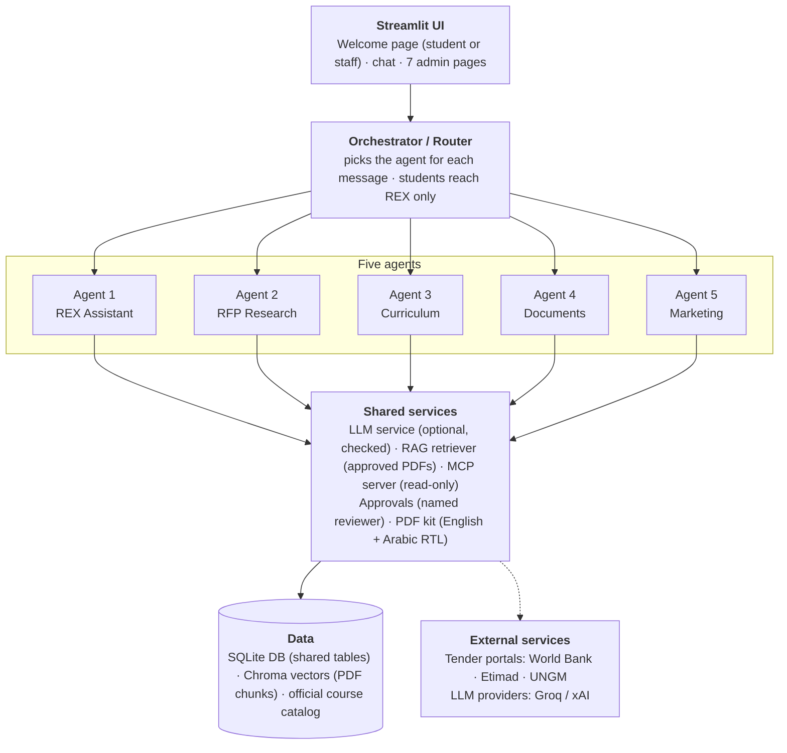
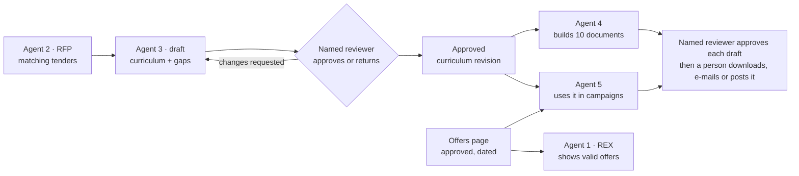

# REX AI: Project Documentation

Last updated: 12 November 2026 · Written by Mariam Hisham (Role 3: architecture, integration and QA) for the REX AI team (Nadin Ahmed, Farah Mahmoud, Mariam Hisham).

## 1. Overview

REX AI is a multi-agent system built for **Andalusia Academy** as the final project of the Andalusia Academy AI Internship (Track 05). It brings five specialised AI agents together behind one chat and one set of admin pages. All five agents share one database, one official course catalog and one knowledge base of approved academy documents.

| # | Agent | What it does | Main owner |
| --- | --- | --- | --- |
| 1 | **REX Assistant** | Bilingual (Arabic/English) course advisor. It recommends tracks from the official catalog, answers questions from approved PDFs with page citations, and captures leads only after explicit consent. | Nadin Ahmed |
| 2 | **Educational RFP & Tender Research** | Finds training tenders in Egypt and Saudi Arabia, filters out anything out of scope, expired or duplicated, assesses the academy's fit and keeps a searchable dashboard. | Mariam Hisham |
| 3 | **Curriculum Research & Accreditation Alignment** | Designs a structured curriculum from approved data, compares it with a competency framework, and runs a named-reviewer approval workflow with PDF export. | Farah Mahmoud |
| 4 | **Educational Content & Document Generation** | Turns an approved curriculum into 10 types of course documents in English or Arabic, optionally following an academy-approved template, with review, approval, PDF and e-mail. | Farah Mahmoud |
| 5 | **AI Marketing** | Writes multi-channel campaigns only from approved data, fact-checks every claim and waits for a named human reviewer before anything is sent. | Nadin Ahmed |

An **Orchestrator / Router** sits between the user and the agents. It reads every chat message, sends it to the right agent, and enforces who may use which agent: students reach REX Assistant only, while signed-in academy staff can reach all five.

### Design principles

The same rules run through every agent:

- **Approved data only.** Facts come from the official course catalog, approved documents, approved curricula and approved offers. Anything the academy has not published (fees, schedules, instructors) is reported as *not available*, never guessed.
- **The LLM is optional and checked.** Every agent works with no API key, using deterministic rules. When an LLM is configured, it rewrites or extracts, and its output is verified against the source before it is used. Any LLM failure falls back to the rule-based result, and the answer is labelled.
- **Humans approve consequential actions.** Curricula, documents, marketing drafts, offers and uploaded templates all need a named reviewer. Leads are saved only after consent. Nothing is published or sent automatically.
- **Honest labels.** Proposals, synthetic demo data and gaps are labelled as such in the UI, the chat and the exported PDFs. No agent ever claims the academy is accredited or qualifies for a tender.

### Project status

All five agents and the orchestrator are implemented and merged into `main` (latest merge: PR #28, 3 November 2026). On 11 November 2026 the RFP agent moved from the demo feed to three live tender sources covering both Egypt and Saudi Arabia (branch `feature/rfp-live-sources`). The suite has about 695 automated tests across 53 test files.

## 2. System architecture



*Every message goes through one router; all agents share one data layer. Dashed lines are external services. `bootstrap.build_app()` creates and connects every box.*

The system is organised in layers. The **Streamlit UI** sends every chat message to the **Orchestrator / Router**, which picks the agent and checks the user's permissions. Each of the **five agents** has its own workflow, but they all use the same **shared services** (LLM, retrieval, MCP, approvals, PDF) and the same **data layer**. Admin pages call each agent's service directly for review and approval.

| Layer | Main modules | Responsibility |
| --- | --- | --- |
| UI | `app.py`, `views/`, `admin_pages/`, `src/ui_context.py`, `src/response_view.py` | Welcome page, chat, admin pages |
| Composition root | `src/bootstrap.py` | Creates and connects every component |
| Orchestrator | `src/agents/orchestrator.py` | Routing, permissions, per-agent state |
| Agents | `src/agents/` plus `src/rfp/`, `src/curriculum/`, `src/documents/`, `src/marketing/` | Each agent's logic and workflow |
| Workflows | `src/workflows/` | Learner profile extraction, course scoring and explanations |
| Knowledge | `src/models/`, `src/knowledge_base/`, `src/ingestion/`, `src/rag/` | Course schema, catalog loading, PDF ingestion and retrieval |
| Services | `src/services/` | LLM, leads, approvals |
| Data | `src/db/`, `migrations/` | Shared SQLite database, repositories, migrations |
| Integration | `src/mcp_server/`, `src/mcp_client/` | The `rex-academy` MCP server and its client |
| Evaluation | `evaluation/` | Measurement scripts, kept outside the request path |

## 3. Technology stack

| Area | Technology | Used for |
| --- | --- | --- |
| Language | Python 3.11+ | All code |
| User interface | Streamlit (multipage, `st.navigation`) | Chat, welcome page and admin pages |
| Agent workflows | LangGraph `StateGraph` | Every agent's flow and the orchestrator |
| LLM access | LangChain (`langchain-groq`, `langchain-xai`) and the Anthropic SDK | Groq, xAI Grok or Anthropic, chosen with `LLM_PROVIDER` |
| Data models | Pydantic v2 | Validated course, request and response schemas |
| Database | SQLite through SQLAlchemy 2, Alembic migrations | Shared database `data/rex.db` (PostgreSQL is a `DATABASE_URL` change) |
| Retrieval (RAG) | pypdf, LangChain text splitter, ChromaDB, scikit-learn hashing embeddings, optional `sentence-transformers` (multilingual-e5-small) | Indexing and searching approved PDFs |
| Integration | Official `mcp` Python SDK 2.3 | The read-only `rex-academy` MCP server and client |
| PDF export | reportlab, arabic-reshaper, python-bidi 0.4.2 (pinned) | English and right-to-left Arabic PDFs |
| Live data | World Bank Procurement Notices API (public, no key) | Real tender notices for Agent 2 |
| Evaluation | RAGAS plus custom evaluation scripts | RAG, course retrieval, curriculum alignment and marketing quality |
| Testing | pytest, Streamlit `AppTest` | Unit, integration and headless UI tests |

Dependencies are listed in `requirements.txt` (runtime), `requirements-dev.txt` (adds testing tools) and `requirements-eval.txt` (adds RAGAS). Tested versions are written next to each line.

## 4. Shared foundation

The agents are independent, but they are built on the same small set of shared parts. This is what lets a curriculum approved in Agent 3 show up in Agent 4's documents and Agent 5's ads without copying any data.

### The agent contract (`src/agents/base.py`)

Every agent implements one interface:

- **`AgentRequest`**: the user's message, the language, the conversation state and the caller's permissions.
- **`AgentResponse`**: the answer text, the agent name, the mode (`llm`, `deterministic` or `error`), structured data and a list of **`SourceReference`** items. A source can be a `course`, a `document` (with page) or a `tender`.
- **`expects_reply(state)`**: an optional hook an agent uses to say "the next message is mine" (REX uses it while collecting consent).

Agents register with the **`AgentRegistry`** (`src/agents/registry.py`), and the orchestrator dispatches to them by name.

### Composition root (`src/bootstrap.py`)

`build_app(settings)` is the one place where every component is created and connected (dependency injection). It loads the settings, migrates the database, loads the catalog, builds the RAG index, creates the LLM service, builds each agent and its services, and registers them. If one agent fails to build, the app still starts and the problem is reported as a warning. The Streamlit pages get the result through `src/ui_context.py`.

### Shared data

| Component | Location | Shared by |
| --- | --- | --- |
| Official course catalog | `data/courses_official.json` → `courses` table, `CourseRepository` | All agents |
| Approved documents (RAG) | `data/documents/*.pdf`, `src/ingestion/`, `src/rag/`, `PassageRetriever` | REX, Curriculum |
| LLM service | `src/services/llm_service.py` (`LLMService`) | Every agent that writes text |
| Database and migrations | `src/db/`, `migrations/versions/` | Every table |
| Approval service | `src/services/approval_service.py` | Marketing, Offers |
| PDF kit | `src/pdf/` | Curriculum, Documents |
| MCP server | `src/mcp_server/academy_server.py` | REX (optional), Marketing, external clients |

The official catalog was transcribed from the academy's 2026–2027 portfolio PDF and holds five tracks, among them Software Testing (TRK-001), Flutter Development (TRK-002) and three data tracks. Fields the portfolio does not publish stay empty.

### Database tables

The schema is created by seven Alembic migrations, and the app migrates automatically at start-up.

| Migration | Tables |
| --- | --- |
| 0001 initial shared schema | `catalog_meta`, `courses`, `documents`, `document_chunks`, `leads`, `evaluation_runs` |
| 0002 rfp opportunities | `rfp_opportunities` |
| 0003 curriculum | `curricula` and their review log |
| 0003 marketing and offers | `marketing_contents`, `offers` |
| 0004 documents | `generated_documents` |
| 0005 document templates | `document_templates` |
| 0006 marketing deliveries | `marketing_deliveries` |

New tables reference `courses.course_id`, so every agent talks about the same courses.

### RAG pipeline

Approved PDFs go through **validate → extract per page → clean → chunk → embed → store**. Validation rejects non-PDFs and oversized, encrypted or text-less (scanned) files. Cleaning removes running headers that the portfolio repeats on every page. Chunks are 800 characters with 120 overlap and keep their page number. Text lives in SQLite and vectors in Chroma with matching ids, and a consistency check (`python -m src.cli check`) reports any mismatch.

A question is embedded, searched against **approved documents only**, filtered by a minimum score and a keyword gate, de-duplicated and returned with page citations. Uploaded documents stay *pending* and are never searched until an admin approves them. Document text is treated as untrusted data and placed inside `<documents>` tags with an instruction to ignore any instructions inside it.

### MCP server (`rex-academy`)

A separate process exposes read-only academy data as MCP tools: `list_courses`, `search_courses`, `get_course`, `search_knowledge_base`, `list_documents`, `get_active_offers`, `get_approved_curriculum` and `list_approved_curricula`, plus a `course://{course_id}` resource. All tools return approved data only and are annotated read-only. Saving leads, approving anything, publishing and sending are deliberately **not** exposed. Setting `COURSE_BACKEND=mcp` makes REX Assistant read courses through the server.

## 5. Agent 1: REX Assistant

**Code:** `src/agents/rex_assistant/`, `src/workflows/`, `src/knowledge_base/`, `src/rag/` · **Page:** the chat (`views/chat.py`) · **Docs:** `docs/architecture.md`, `docs/agent1_audit.md`

REX Assistant is the student-facing advisor and the default agent of the chat. It talks in **Arabic or English** (including Egyptian Arabic), asks only for missing information, and answers from approved data.

### What it can do

- **Recommend tracks.** It extracts a learner profile (goal, background, level) from the conversation, scores every course in the official catalog and explains why each match fits. Retrieval is keyword-based by default; a semantic retriever (multilingual-e5-small) can be switched on with `COURSE_RETRIEVER=semantic`. A course resolver understands nicknames and course IDs, and a synonym check prevents false matches.
- **Answer course facts.** Hours, modules, tools, capstone, deliverables and career paths come from the structured course record. Fields the academy has not published (fees, schedules, instructors, delivery format) are answered with **"not available"**.
- **Answer from documents.** Other questions are answered from approved PDF passages with **page citations**. When the documents don't contain the answer, it says so instead of guessing.
- **Show approved offers.** If an offer is approved and still valid for a course, REX mentions it with its end date.
- **Capture leads with consent.** Typing `register` or `سجلني` starts a consent flow. Nothing is stored before the user says yes, and personal data is never written to the logs.

### Conversation graph (LangGraph)

`analyze` makes a deterministic routing decision (language, consent flow, course reference, question type, learner profile) and sends the turn to one of seven nodes: `recommend`, `course_question`, `catalog_overview`, `clarify_course`, `document_question`, `follow_up` or `lead_capture`. Every path ends in `finalize`, which adds notes, the language and the conversation state returned to the UI.

When an LLM is configured, it only **rewrites facts that were already retrieved**. Any failure falls back to the deterministic answer, and the answer is labelled so the user knows which one they got.

### Example

| User types | REX answers |
| --- | --- |
| `I'm a final-year student and want to become a QA automation engineer` | Software Testing (TRK-001), with reasons |
| `how long is it?` | 100 hours |
| `How much is the Flutter Development track?` | Fee **not available** |
| `Who can I contact about partnerships?` | Answer cited to page 9 of the portfolio |
| `عايز اشتغل مطور فلاتر` | Arabic answer recommending Flutter (TRK-002) |

## 6. Agent 2: Educational RFP & Tender Research

**Code:** `src/rfp/`, `src/agents/rfp_research/`, `src/db/rfp_repository.py` · **Page:** `admin_pages/3_RFP_Opportunities.py` · **Docs:** `docs/rfp_agent.md`

Agent 2 finds **real** education and training tenders (RFPs, RFQs, calls for proposals) in **Egypt and Saudi Arabia only**. It extracts the key facts, removes anything out of scope, not really training, expired or duplicated, gives a first assessment of the academy's fit, and stores the results for the dashboard and the chat.

### Sources (all live, real tenders)

| Source | Country | What it is | How it is read |
| --- | --- | --- | --- |
| **World Bank Procurement Notices API** (`src/rfp/worldbank.py`) | Egypt | Official notices for World Bank-financed projects | Public JSON API, no key. Contract awards are skipped, and the full notice document (HTML) is read for requirements and deadlines. |
| **Etimad** (`src/rfp/etimad.py`) | Saudi Arabia | The official Saudi government procurement portal | The public visitor tender list (JSON): open tenders from the last 3 months, searched with Arabic training words (تدريب، تأهيل، دورات، بناء القدرات…), pages read in order with a 1-second pause. |
| **UN Global Marketplace** (`src/rfp/ungm.py`) | Egypt + Saudi Arabia | Where UN agencies (UNDP, UNIDO, UNICEF…) publish tenders | The public notice search, with the same request the website sends: active notices only, filtered to Egypt and Saudi Arabia by UNGM's country IDs. |

The default is `RFP_SOURCES=worldbank,etimad,ungm`. A source that can't be reached is reported on the dashboard, and the scan continues with the others. Etimad and UNGM are read through the public endpoints their own websites use, not documented APIs, so a change on their side shows up as a warning.

`python -m src.rfp.check_sources` checks all three sources live and prints how many tenders each returned per country, with examples. A live check on 11 November 2026 read 26 World Bank notices (Egypt), about 150 Etimad tenders and 27 UNGM notices (25 Egypt, 2 Saudi Arabia). About 15 of them were real open training tenders.

The synthetic demo feed (`data/rfp/sample_tenders.json`) is now used **only by the automated tests**. When it is not a configured source, demo rows left from earlier scans are deleted at start-up.

### Scan pipeline (LangGraph)

`fetch → screen → ai_review → deduplicate → assess → ai_analyze → summarize → store → alert`

| Step | What happens |
| --- | --- |
| fetch | Reads every configured source. |
| screen | Extracts title, organization, country, deadline, eligibility, category, link and publication date, then applies three rules in order: **market** (Egypt or Saudi Arabia), **training-related**, **not expired**. Every excluded listing gets exactly one reason. |
| ai_review | *LLM, optional.* Re-reads listings rejected only as "not training" (right country, still open) and may keep them. |
| deduplicate | Same link, or same organization with ≥ 88% similar title, counts as a duplicate, both against the database and inside the batch. |
| assess | Fit is **strong**, **possible** or **weak**, with reasons, based on matching the notice to catalog topics. It lists requirements to verify and never says the academy "qualifies". |
| ai_analyze | *LLM, optional.* Reads each new notice for requirements, a deadline (if the source gave none), a fit explanation and matching tracks. |
| summarize | Short LLM summary, with a deterministic fallback. A summary that drops the deadline is rejected. |
| store | Upsert by a dedup key. Human decisions (reviewed or dismissed) are never overwritten; past deadlines become *expired*. |
| alert | New Egypt opportunities become alerts, shown once. |

**Business rule:** Egypt tenders are flagged for **immediate review**, and Saudi tenders go to the **monitored** pipeline.

### Training or not? (`src/rfp/extraction.py`)

A tender is training-related when it uses training words (English and Arabic) **and** is not really a purchase of goods or works. Real tenders showed why the second check matters: Etimad lists *furnishing a training wing*, *maintenance of training centres*, *تأهيل مبنى* (renovating a building) and *printing training bags*, and UNGM lists *installation of training stations* and *hotel services for a training*. All of them mention training but buy something else.

- A title that **starts** with a purchase or works word (توريد، صيانة، تأثيث، طباعة، استبدال, *supply of*, *installation of*…), or whose first word is تأمين ("procure"), is not a training tender.
- A purchase word anywhere else excludes it, unless the text clearly asks for a training **service** (خدمات تدريب، برامج تدريبية، تدريب منسوبي، بناء القدرات, *training services*, *capacity building*…).
- **تأهيل** alone also means renovating a building, a well or a kitchen, so it only counts in phrases about people, such as برنامج تأهيل or تأهيل مسؤولي.

The real titles from the live checks are kept as tests, so the filter can't silently get worse.

### Reading real notice documents (`src/rfp/documents.py`)

World Bank notices arrive as long HTML documents rather than neat fields. The agent converts the HTML to plain text, pulls out up to four **requirement sentences** (experience, registration, licences, certificates, "must have", "at least", in English and Arabic) and reads the **deadline** from deadline sentences only. Nothing is guessed: if nothing is found, the field stays empty.

### The AI steps and how they are verified (`src/rfp/ai.py`)

One LLM call per tender reads the notice and returns JSON. The notice is placed between `<notice>` tags, and the prompt says to ignore any instructions inside it. Only the parts that pass verification are used:

| LLM output | Accepted only if… |
| --- | --- |
| Evidence for "this is a training tender" | The quote really appears in the notice (≥ 25 characters, after normalisation) **and** talks about learning. |
| Requirements | At least 60% of the content words appear in the notice. |
| Deadline | Its day and year appear in the notice text. |
| Matching tracks | The track IDs exist in the catalog. |
| Fit explanation | It never claims the academy qualifies. |

The LLM can never change the country decision (out-of-market listings never reach it) or decide the fit level, which stays with the rules. Rejected items are listed for transparency, calls are capped with `RFP_AI_MAX_CALLS` (default 20), and any failure keeps the rule-based result.

### Dashboard and chat

The RFP Opportunities page runs a scan and shows the results: a summary line, each source's status, the reason for every excluded listing, the Egypt alerts, and a table with filters, search, a status workflow (new, reviewed, dismissed) and a CSV export for Excel or Google Sheets. In the chat, staff can type `scan`, `egypt`, `saudi` or a tender ID such as `RFP-1a2b3c` (Arabic: `ابحث`, `مصر`, `السعودية`). Matching tenders also feed Agent 3 as market signals.

## 7. Agent 3: Curriculum Research & Accreditation Alignment

**Code:** `src/curriculum/`, `src/agents/curriculum/` · **Page:** `admin_pages/5_Curriculum.py` · **Docs:** `docs/curriculum_agent.md`

Agent 3 designs a structured curriculum from approved academy data, compares it with a competency framework, lets an instructor review and edit it, and exports a PDF. It **proposes** alignment and never says a course is accredited.

`request → research → draft (deterministic) → [optional LLM enrichment] → alignment → review → approved`

### What a curriculum contains

Objectives, target audience, prerequisites, numbered learning outcomes (LO1…), modules and topics, training hours, practical exercises per module, an assessment scheme whose weights add up to 100%, a capstone project, an accreditation-alignment report, a PDF and a review log.

### Research step

1. **Course record**: title, department, modules, tools, capstone, deliverables and career paths.
2. **Approved documents (RAG)**: the top passages for the course, cited with page.
3. **Topic detail**: topics transcribed from the portfolio (`data/curriculum/track_topics.json`). How topics are assigned to modules is a team proposal, and every curriculum says so.
4. **RFP signals from Agent 2**: open tenders that match the course give a market signal (how many tenders per country) and **market suggestions**: skills the tenders mention that the curriculum doesn't. Suggestions are listed for the reviewer and are never added automatically.

### Traceability

Every topic, outcome, prerequisite and exercise carries an `origin`: `catalog`, `document`, `framework`, `user`, `template`, `llm` or `market`. Template and LLM content is marked as a **proposal** that must be reviewed. Gaps are never filled silently: they are listed under *Gaps and assumptions* and in the PDF.

### Framework alignment

The curriculum is compared with team-assembled reference checklists in `data/frameworks/`: **ISTQB CTFL 4.0**, **SWEBOK 3**, **CRISP-DM** and a **data engineering lifecycle**. Each framework area is marked as covered, partly covered or a gap. This alignment was evaluated on 88 human labels, with an exact accuracy of **0.864** (see Testing and evaluation).

### Review workflow

Draft → submitted → approved or changes requested, always by a **named reviewer**. Only **approved** curricula are used by other agents: Agent 4 builds documents from them, and Agent 5 uses their learning outcomes and module titles in campaigns (also available over MCP as `get_approved_curriculum`). In the chat, staff can type `create a curriculum for TRK-001`.

## 8. Agent 4: Educational Content & Document Generation

**Code:** `src/documents/`, `src/agents/document_generation/`, `src/pdf/` · **Page:** `admin_pages/6_Documents.py` · **Docs:** `docs/document_agent.md`

Agent 4 turns an **approved curriculum** (or, if there isn't one, the course record) into ready-to-review course documents in **English or Arabic**. Every document is a draft until a named reviewer approves it.

`approved curriculum → template → [optional LLM: Arabic translation, MCQs] → DRAFT → edit → approve → PDF / Markdown / e-mail`

### The ten document types

Course description · Course proposal · Curriculum PDF · Participant guide · Facilitator/instructor guide · Presentation outline · Question bank · Assessment rubrics · Capstone project brief · Learning outcomes and assessment plan.

### What it will and won't write

- **From data only.** Text is rearranged from the curriculum or course record. A fee, schedule, instructor or delivery format that hasn't been published prints as **"Not published"**.
- **Proposals are labelled.** Teaching-time splits, capstone milestones, rubric descriptors and question wording are marked as template proposals.
- **No accreditation claims.** Every document carries a disclaimer, and a test scans all 10 types in both languages for claims.
- **The basis is printed.** The cover says whether the document was built from an approved curriculum (with its revision) or from the course record.

### Academy-approved templates

The academy can upload **its own document** (Word .docx works best; PDF, Markdown and text also work) as the template for a document type and language, from the **Academy templates** tab on the Documents page.

1. **Upload.** REX AI keeps only the **section headings**, in order: Word heading styles, Markdown `#`, or heading-like lines in a PDF or text file. The template's own body text is never copied. The same file can't be uploaded twice.
2. **Approve.** A template stays *pending* and is never used until a named reviewer approves it. Approving one retires the previous approved template for that type and language; rejecting or deleting stops its use.
3. **Generate.** The document follows the academy's headings and order. Each heading gets the generated section that matches it best (synonyms such as *Objectives* ≈ *What you will achieve*, Arabic included). A numbered series (Module 1, Module 2…) moves together. A heading with no matching data gets a visible **"to be completed"** note, and generated sections the template has no place for are kept at the end and listed for the reviewer.

### Output and distribution

Approved documents download as a PDF (English, or right-to-left Arabic with correct letter shaping) or Markdown. They can optionally be e-mailed through SMTP, which stays disabled until `SMTP_HOST` is set. In the chat, staff can type `generate a participant guide for TRK-001`.

## 9. Agent 5: AI Marketing

**Code:** `src/marketing/`, `src/agents/marketing_agent/`, `src/services/approval_service.py` · **Pages:** `admin_pages/4_Marketing.py`, `admin_pages/5_Offers.py` · **Docs:** `docs/marketing_agent.md`, `docs/marketing_agent_design.md`

Agent 5 writes marketing campaigns **only from approved academy data**, checks every claim, scores quality and waits for a **named human reviewer**. The agent itself never publishes or sends anything.

### Channels and content

Social captions, Facebook/Instagram ads, LinkedIn posts, e-mails and WhatsApp messages, in Arabic or English. Every draft has a headline, a body and a call to action (plus a subject line for e-mail). A campaign has 1–5 variations (3 by default) and a simple strategy.

### How a campaign is made

The workflow is a LangGraph graph. Each step is a small, separately tested class:

| Step | Class | Role |
| --- | --- | --- |
| Parse the brief | brief parser | Asks a follow-up question if the course, platform or objective is missing. |
| Load facts | `CourseFactsProvider` | Reads the course record, approved offers valid today and the **approved curriculum** (through `CurriculumServiceSource`). |
| Plan | `StrategyPlanner` | Picks platforms and a simple strategy. |
| Generate | `ContentGenerator` | LLM structured output, or deterministic templates with no key. |
| Fact-check | `ClaimValidator` | Blocks invented prices, discounts, dates, formats, accreditation and guarantees, in English and Arabic. A blocked draft is regenerated (up to `MARKETING_MAX_ATTEMPTS`) and then dropped. |
| Score | `MarketingEvaluator` | Scores objective alignment, completeness, CTA quality, language and platform formatting. |
| Approve | `ApprovalService` | Every draft is *pending review* until a named reviewer approves it. |

### Offers

Discounts live on the Offers page. An offer must be approved and dated before Agent 1 or Agent 5 can mention it, and both agents read the same approved offers (also over MCP as `get_active_offers`).

### Sending approved drafts

Only approved drafts can be sent, by a person, from the **Approved** tab (`src/marketing/distribution.py`). E-mail uses the SMTP settings, and LinkedIn uses a member or organisation access token. The default `MARKETING_DELIVERY_MODE=dry_run` checks and logs without sending anything; `live` really sends. Every delivery is recorded in `marketing_deliveries`.

If a reviewer edits a draft to say "only 1500 EGP", the re-check blocks the invented price and the Approve button is disabled.

## 10. Orchestrator and cross-agent workflows

### The orchestrator (`src/agents/orchestrator.py`)

The main chat sends **every** message to `OrchestratorAgent`. It decides which agent answers and forwards the message unchanged. It never answers by itself, never approves or sends anything, and never logs message text.

It has two parts:

- **`IntentRouter`**: deterministic, bilingual keyword scoring with no LLM, so it is instant and fully unit-tested. Record IDs (`RFP-…`, `CUR-…`, `DOC-…`) score highest, then document names, strong phrases and hints. Hints alone never move the conversation: "digital marketing" is a course, not a campaign request.
- **`OrchestratorAgent`**: implements the agent contract and runs a small LangGraph workflow (`analyze` → `dispatch`, `clarify`, `switch`, `deny` or `help`). Each response names the agent that really answered and explains the routing decision.

**Routing order** (the first rule that applies wins):

1. `/help` or `/agents` lists the agents this user may use.
2. If a clarifying question is open and the user answers `1`, `٢` or an agent name, the original request goes to that agent.
3. An explicit command: `/rex`, `/rfp`, `/curriculum`, `/documents`, `/marketing`, `switch to marketing` or `حولني للتسويق`.
4. The active agent is waiting for this user's reply (for example, REX collecting consent).
5. A strong keyword signal for exactly one agent. A tie with the active agent stays with it; any other tie asks the user.
6. Otherwise the active agent continues (follow-up answers).
7. Otherwise REX Assistant, the student-facing default.

**Permissions** follow least privilege: by default only REX is allowed. The UI unlocks the other four agents only after the staff sign-in, so a student's `/marketing` gets a polite refusal. **State** is kept per agent, so switching to the RFP agent and back resumes a marketing brief exactly where it was. If an agent is unavailable or raises an error, the user gets a friendly message and the other agents keep working.

### How the agents work together



*One approved curriculum feeds documents and campaigns. Agent 5 reads the same approved offers as REX.*

The agents pass **approved** data to each other through the shared database, never drafts:

- **Agent 2 → Agent 3:** open tenders that match a course become market signals and skill suggestions for the curriculum reviewer.
- **Agent 3 → Agent 4:** documents are built from the newest approved curriculum, and the cover says which revision.
- **Agent 3 → Agent 5:** approved learning outcomes and module titles become facts the ads can use, each labelled with its source. This implements the brief's workflow *Curriculum approved → Marketing agent generates campaign → Admin reviews*.
- **Offers → Agents 1 and 5:** only approved, dated offers that are valid today are mentioned, by REX in the chat and by Marketing in campaigns.

## 11. User interface

`app.py` is only a router (`st.navigation`). It opens a **Welcome** page (`views/welcome.py`) that asks who is using the app.

| Role | What they see |
| --- | --- |
| **Student** | The REX Assistant chat only. Each answer shows a plain note on where it came from and a **Sources** list. Admin pages don't appear in the navigation at all. |
| **Academy staff** (needs `ADMIN_PASSWORD`) | The chat with all five agents, plus the admin pages. Each answer also shows which agent replied, why it was routed there and whether an LLM wrote the text. |

**Change role / Sign out** in the sidebar returns to the Welcome page and clears the chat. Answer layout is in `src/response_view.py`, and the shared look in `src/ui_theme.py`.

### Admin pages

| Group | Page | Purpose |
| --- | --- | --- |
| Academy data | Knowledge base (`1_Knowledge_Base.py`) | Upload PDFs, approve or reject, replace, delete, test retrieval |
| Academy data | Leads (`2_Leads.py`) | Consented leads (personal data, password-protected) |
| Academy data | Offers (`5_Offers.py`) | Propose and approve dated offers |
| Agents | RFP Opportunities (`3_RFP_Opportunities.py`) | Run a scan, filter, review, export CSV |
| Agents | Curriculum (`5_Curriculum.py`) | Create, align, edit, submit, approve, download PDF |
| Agents | Documents (`6_Documents.py`) | Generate, edit, approve and download documents; manage academy templates |
| Agents | Marketing (`4_Marketing.py`) | Generate campaigns, review, approve, send approved drafts |

The same operations are available from the command line: `python -m src.cli ingest file.pdf --approve`, `list-docs`, `approve ID`, `replace ID new.pdf`, `remove ID --yes`, `reindex`, `check` and `ask "question"`.

## 12. Installation, configuration and running

### Install and run (Python 3.11+)

```bash
git clone https://github.com/NadiinAhmed/REX-AI.git
cd REX-AI
python -m venv .venv
.venv\Scripts\activate            # macOS/Linux: source .venv/bin/activate
pip install -r requirements-dev.txt
copy .env.example .env             # macOS/Linux: cp .env.example .env
python -m pytest                   # run the tests
streamlit run app.py               # opens http://localhost:8501
```

The first start creates `data/rex.db`, loads the official catalog and indexes the PDFs in `data/documents/`. With the default settings everything runs **without an API key**, in deterministic mode.

### Configuration (`.env`)

`.env.example` lists every setting with a safe default. Copy it to `.env` and put keys only in `.env`, which must never be committed.

| Setting | Default | Meaning |
| --- | --- | --- |
| `LLM_PROVIDER` | `none` | `none`, `groq`, `xai` or `anthropic` |
| `GROQ_API_KEY` / `XAI_API_KEY` / `ANTHROPIC_API_KEY` | empty | The key for the chosen provider |
| `LLM_MODEL` | empty | Empty uses the provider default |
| `ADMIN_PASSWORD` | empty | Staff sign-in and admin pages; set it before sharing a demo |
| `DATABASE_URL` | `sqlite:///data/rex.db` | Shared database |
| `EMBEDDING_PROVIDER` | `hashing` | `hashing` (offline) or `sentence_transformers` (semantic) |
| `COURSE_RETRIEVER` | `keyword` | `keyword` or `semantic` |
| `COURSE_BACKEND` | `direct` | `direct` or `mcp` |
| `RFP_SOURCES` | `worldbank,etimad,ungm` | Live tender sources for Agent 2; add `file` for the synthetic demo feed |
| `RFP_MAX_PAGES` | `3` | Result pages read per search on Etimad and UNGM |
| `RFP_AI` / `RFP_LLM_SUMMARIES` | `auto` | LLM steps of Agent 2 (on when an LLM is configured) |
| `RFP_AI_MAX_CALLS` | `20` | LLM calls per scan |
| `SMTP_HOST` and related | empty | E-mail for approved documents and marketing drafts (disabled when empty) |
| `MARKETING_DELIVERY_MODE` | `dry_run` | `dry_run` logs only; `live` really sends |

To use a free Groq key: set `LLM_PROVIDER=groq` and `GROQ_API_KEY=gsk_…`, then restart the app. For better Arabic and semantic search, run `pip install sentence-transformers` and set `EMBEDDING_PROVIDER=sentence_transformers`; documents are re-indexed automatically.

### Demo script

1. Sign in as a student and type `Hi`, then `I want to become a QA automation engineer`, then `how long is it?`.
2. Ask `How much is the Flutter Development track?` (fee not available) and `Who can I contact about partnerships?` (cited to page 9).
3. Type `register`, then `yes`, then a name and e-mail. The lead appears on the Leads page.
4. Sign in as staff. On **RFP Opportunities**, click *Run scan* and open an Egypt tender.
5. On **Curriculum**, create a curriculum for TRK-001, align it and approve it as a named reviewer.
6. On **Documents**, generate a participant guide for TRK-001 and download the PDF.
7. On **Marketing**, generate a LinkedIn campaign for TRK-001, edit a draft to add a price and watch the check block it.

## 13. Testing and evaluation

### Automated tests

Run everything with `python -m pytest` (about two minutes; the MCP tests start a real server process). The suite has about 695 tests in 53 files, and none of them need an API key or the internet: LLM calls are replaced with fakes, the World Bank, Etimad and UNGM portals are faked, and test PDFs are generated inside the tests. The live tender sources are checked separately with `python -m src.rfp.check_sources`.

| Area | Example test files | What they prove |
| --- | --- | --- |
| REX Assistant | `test_rex_assistant.py`, `test_recommendation.py`, `test_rex_documents_and_leads.py`, `test_semantic_retriever.py`, `test_synonym_false_matches.py` | Recommendations, page citations, "not found", consent flow, no personal data in logs |
| RAG and data | `test_ingestion.py`, `test_database.py` | Pending vs approved, duplicates, corrupt and scanned files, migrations, rollback |
| RFP agent | `test_rfp_agent.py`, `test_rfp_worldbank.py`, `test_rfp_live_sources.py`, `test_rfp_ai.py` | Market filter, expiry, duplicates, real-notice reading, Etimad and UNGM parsing, both markets in one scan, goods/works tenders rejected (using real titles), every LLM verification rule, failure fallback |
| Curriculum | `test_curriculum_*.py` | Traceability, alignment, review workflow, PDF |
| Documents | `test_document*.py`, `test_document_templates.py` | 10 types × 2 languages, no invented facts, templates and their approval |
| Marketing | `test_marketing_*.py` | Fact-checker, LangGraph routes, approval gate, no publishing code, distribution |
| Integration | `test_orchestrator.py`, `test_mcp.py`, `test_integration.py`, `test_app_ui.py` | Routing and permissions, a real MCP subprocess, headless Streamlit pages |

### Evaluation (`evaluation/`)

| What | How it is measured | Result |
| --- | --- | --- |
| RAG retrieval (RAGAS) | 22 questions on the portfolio PDF (11 English, 5 Arabic, 6 unanswerable) | Page recall **0.919**, non-LLM context precision **0.911** |
| Course retrieval | hit@1, hit@3 and abstention on direct, paraphrased and off-topic requests | Keyword: hit@3 0.667, abstention 1.0. Semantic (e5-small, min score 0.84): hit@3 0.778, abstention 1.0 |
| Curriculum alignment | 88 human labels | Exact accuracy **0.864**; Arabic held-out 0.667 |
| Marketing checker and drafts | Labelled checker cases and campaign dataset | Checker precision **1.0**, recall **0.77**; draft pass rate 1.0 (deterministic templates) |
| Live LLM check | `python -m evaluation.live_check` with Groq `openai/gpt-oss-20b` | 9 REX scenarios run end to end (results in `evaluation/live/`) |

Each run writes its configuration and scores to a dated folder, and runs can be compared with the `compare` scripts. Known misses are kept in the datasets on purpose, so the figures stay honest.

## 14. Development process and contributions

### Team and roles

| Member | Role |
| --- | --- |
| **Nadin Ahmed** | Agent 1 REX Assistant, Agent 5 Marketing, the orchestrator, semantic retrieval, final integration and most merges into `main` |
| **Farah Mahmoud** | Knowledge base, Agent 3 Curriculum and Agent 4 Document Generation |
| **Mariam Hisham** | Role 3 (system architecture, UI structure, integration and QA, project documentation) and Agent 2 RFP Research |

### Git workflow

Every feature was built on its own branch (`feature/…`) and merged into `main` through a pull request, after the test suite passed. Commit messages carry task IDs from the work breakdown (`ARC-01`, `QA-02`, `RFP-08` and so on). The process is described in `docs/git_workflow.md`, and the task board and work breakdown are in `docs/task_board.md` and `docs/work_breakdown_structure.md`.

### Timeline (pull requests into `main`)

| Sprint | Dates | Pull requests | What was delivered |
| --- | --- | --- | --- |
| **Sprint 1: foundation** | 17–18 Oct 2026 | #1–#6 | Architecture, UI skeleton and QA setup (Mariam), knowledge base (Farah), first REX Assistant (Nadin) |
| **Sprint 2: the agents** | 24–26 Oct 2026 | #7–#13 | REX Assistant on LangGraph with RAG and MCP, RFP Research agent, Marketing agent, Curriculum agent, Document agent |
| **Sprint 3: integration and intelligence** | 1–3 Nov 2026 | #14–#28 | Marketing–curriculum link, approved offers in REX, the orchestrator, semantic course retriever and course resolver, real World Bank tenders with LLM analysis, curriculum requirements, academy document templates, live LLM evaluation, e-mail and LinkedIn delivery, student/staff entry UI, synonym false-match fixes |
| **Final polish** | 11 Nov 2026 | `feature/rfp-live-sources` | RFP agent on three live sources (World Bank, Etimad, UNGM) for Egypt and Saudi Arabia, demo feed removed from scans, goods/works filter tuned on real tenders, live source check (Mariam) |

### Contribution summary (non-merge commits on `main`)

| Author name in Git | Commits | Notes |
| --- | --- | --- |
| Nadin Ahmed | 36 | Plus most pull-request merges |
| Mariam Hisham | 16 | 5 in Sprint 1, 6 in Sprint 2, 5 in Sprint 3 (merge of PR #19 shows as "Mariam Saad") |
| "Sprint 2 Author (replace)" | 16 | Farah's Curriculum and Document work, committed under a placeholder name |
| farah-mahmoudx | 7 | Farah's other commits |
| Claude (AI assistant) | 9 | Commits made with an AI coding assistant |
| REX AI / REX AI dev | 3 | Setup commits |

### Mariam's commits in detail

- **Sprint 1:** ARC-01, ARC-02, ARC-04/05, ARC-06 with QA-01, QA-02 with DOC-01 to DOC-03 (architecture, bootstrap, agent contract, UI structure, test setup and documentation).
- **Sprint 2 (RFP-01 to RFP-07):** the `rfp_opportunities` table, the screening rules, the agent, the dashboard, the docs and the README section.
- **Sprint 3 (RFP-08 to RFP-12):** reading real notice documents, the World Bank source, dashboard sources, the AI review and analysis steps, and showing AI results on the dashboard.
- **Final polish (RFP-13):** the Etimad and UNGM sources, live-only default sources with the demo rows removed, the goods/works filter for training words, the `check_sources` command and their tests. Also this project documentation.

## 15. Limitations and future work

### Known limitations

- **Missing academy data.** Fees, schedules, instructors, delivery format, level and some course hours aren't in the portfolio, so they stay empty until the academy provides them.
- **Tender sources.** Etimad and UNGM are read through the public endpoints their websites use, not documented APIs, so they can change without notice. Egypt's own government portal (EPS-GAGS / etenders.gov.eg) is not connected yet, so Egypt comes from the World Bank and UNGM. Hijri dates are not converted, and RFP alerts appear in the app only.
- **LLM measurements.** REX was checked live with Groq. The LLM steps of the RFP, curriculum, document and marketing agents are tested with fake LLMs, but not yet measured with a live model. No evaluation set exists yet for the RFP agent.
- **Rule-based checks.** The marketing claim checker misses paraphrases (recall 0.77). The RFP training filter is keyword-based and was tuned on real titles from November 2026; new wording can still slip through. Default embeddings match spelling rather than meaning.
- **No OCR.** Scanned PDFs without a text layer are rejected.
- **Simple access control.** Admin pages use one shared password, not user accounts. SQLite and local Chroma suit a single app process.
- **Commit authorship.** Some of Farah's Sprint 2 commits are recorded under a placeholder author name (see [section 14](#14-development-process-and-contributions)).

### Future work

1. Connect Egypt's government procurement portal, and add an evaluation set of labelled real tenders for Agent 2.
2. Measure every agent's LLM steps with a live model, using the existing evaluation scripts.
3. Make the semantic retriever the default once it beats keyword search on held-out queries.
4. Add OCR for scanned PDFs, Hijri date conversion, and e-mail alerts for new Egypt tenders.
5. Replace the shared password with user accounts and roles, and move to PostgreSQL for multi-user deployment.
6. Let the academy fill the missing catalog fields from an admin form.
