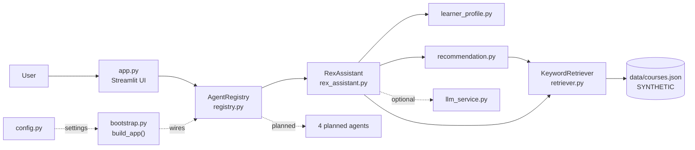

# Role 3 — Architecture, UI, Integration & QA Guide

**Branch:** `feature/ui-architecture-qa` · **Your PRs:** PR1 (first) and PR4 (last) · **Repository:** https://github.com/NadiinAhmed/REX-AI

> **In one sentence:** you build the frame of the building and its front door. The other two roles build rooms inside it. You make sure every room connects to the hallway, and that a visitor can walk in and get an answer.

---

## 1. Role overview and Sprint 1 goal

Sprint 1 is finished when **anyone can clone `main`, install, run the tests, start the app, and demo the chatbot** with the sample data. You own that moment. Concretely, you:

- set up the GitHub repository and the three feature branches;
- deliver the shared foundation everyone else builds on (PR1);
- review and merge the other roles' pull requests in the right order;
- deliver the app, the wiring code, the integration tests and the documentation (PR4);
- run the final demo.

**Key words used in this guide**

| Term | Meaning |
|---|---|
| **Repository (repo)** | The project folder tracked by Git, stored on GitHub. |
| **Branch** | A separate line of work. Changes on your branch don't affect `main` until merged. |
| **Commit** | A saved snapshot of your changes, with a message and your name. |
| **Push** | Upload your commits to GitHub. |
| **Pull request (PR)** | A request on GitHub: "please review my branch and merge it into `main`." |
| **Merge** | Combine one branch's commits into another. |
| **Integration** | Making separately built parts work together. |
| **Entry point** | The file you run to start the program (`app.py`). |
| **Interface / contract** | The agreed function names, inputs and outputs between parts. |

## 2. Responsibilities and scope

**You do:**
- Repository setup, branches, branch protection, PR reviews and merging.
- Your files (listed in section 3): config, logging, agent contract, registry, bootstrap, UI, integration tests, docs.
- Running all tests on `main` after every merge.
- The demo and the final checklist.

**You do NOT:**
- Rewrite Role 1's or Role 2's code. If their PR breaks something, you send them the error output; they fix it.
- Change a shared interface (`docs/interfaces.md`) without both other roles approving.
- Push anything directly to `main`.

## 3. The architecture and folder structure

### Your files

| File | What it does | PR |
|---|---|---|
| `src/config.py` | Reads settings from environment variables (`load_settings()` → `Settings`). Raises `ConfigError` for bad values. Keeps the API key out of logs (`repr=False`). | PR1 |
| `src/utils/logging_config.py` | `configure_logging()` and `get_logger()`. Logs record events, never secrets or message text. | PR1 |
| `src/agents/base.py` | **The shared contract.** `AgentRequest` goes in, `AgentResponse` comes out. Every agent implements `Agent.handle()`. | PR1 |
| `src/agents/registry.py` | `AgentRegistry`: the receptionist. `register()`, `dispatch()`, `list_agents()`. The 4 future agents are listed as *planned*. | PR1 |
| `tests/conftest.py` | Shared test fixtures (reusable test setup), e.g. `catalog`, `retriever`. | PR1 |
| `tests/test_config.py`, `tests/test_registry.py` | Your unit tests. | PR1 |
| `requirements.txt`, `.env.example`, `.gitignore`, `pytest.ini` | Dependencies, config template, files Git must ignore, test settings. | PR1 |
| `.github/pull_request_template.md` | Pre-fills every PR description on GitHub. | PR1 |
| `docs/interfaces.md` | Written contract between the three roles. | PR1 |
| `src/bootstrap.py` | `build_app()`: the one place that wires data + LLM + agent + registry. | PR4 |
| `app.py` | The Streamlit chat UI (the entry point). | PR4 |
| `tests/test_integration.py`, `tests/test_app_ui.py` | End-to-end tests (whole flow, and the UI without a browser). | PR4 |
| `README.md`, `docs/*` | Project documentation. | PR4 |

The exact file lists are in `docs/sprint1_handoff/pr1_role3_foundation.txt` and `pr4_role3_integration.txt`.

### The whole project at a glance

```
app.py                         UI (you)
src/
  config.py, bootstrap.py      settings + wiring (you)
  agents/base.py, registry.py  contract + router (you)
  agents/rex_assistant.py      chatbot logic (Role 1)
  agents/prompts.py            LLM rules (Role 1)
  workflows/                   profile + recommendations (Role 1)
  services/llm_service.py      LLM interface (Role 1)
  models/course.py             course schema (Role 2)
  knowledge_base/              loader + search (Role 2)
data/courses.json              demo course catalog (Role 2)
tests/                         tests, split by role
docs/                          documentation (you, with input from all)
```

## 4. Entry point, configuration, registry and UI

**What happens when a user types a message** (follow it in the code once with a pen):

1. `app.py` receives the text from `st.chat_input` (Streamlit's chat box).
2. It builds `AgentRequest.from_text(prompt, st.session_state.agent_state)`. The `state` carries the conversation memory from the previous turn.
3. `ctx.registry.dispatch("rex_assistant", request)` sends it to the right agent.
4. Role 1's `RexAssistant.handle()` does the work, using Role 2's retriever.
5. An `AgentResponse` comes back with `text`, `mode`, `sources` and the new `state`.
6. `app.py` shows the text, a **mode badge** (LLM or rule-based) and the **sources**, and saves `response.state` for the next turn.

**Why `bootstrap.py` exists:** `build_app()` is the only place where the parts are connected. Both `app.py` and `tests/test_integration.py` call it, so the tests check the *same wiring* the real app uses.

**Why the agent returns `state` instead of remembering:** agents stay *stateless* (they keep no memory between calls). That makes them easy to test (give input, check output) and safe to run for many users at once.

**Why the 4 planned agents raise `AgentNotImplementedError`:** the UI and docs show the roadmap honestly. Nothing pretends to work before it does.

**Configuration** is read from environment variables or a local `.env` file (`.env` is ignored by Git). With `LLM_PROVIDER=none` (the default), no API key is needed.

## 5. Architecture diagram

GitHub shows this diagram automatically. In VS Code, install the extension "Markdown Preview Mermaid Support" to see it.



A larger diagram, with a step-by-step sequence diagram, is in `docs/architecture.md`.

---

## 6. Step-by-step tasks

### Two-day schedule (same table in all three guides)

| When | Who | Task | Priority | Depends on |
|---|---|---|---|---|
| Day 1, 0:00–0:45 | All | S-01 Set up the package and run its tests | **Must Do** | — |
| Day 1, 0:45–1:15 | **Role 3** + repo owner | ARC-00 Invite collaborators, create branches, protect `main` | **Must Do** | — |
| Day 1, 1:15–1:30 | All | S-02 Clone repo, set Git identity, switch to own branch | **Must Do** | ARC-00 |
| Day 1, 1:30–2:45 | **Role 3** | PR1: study and submit the foundation | **Must Do** | S-02 |
| Day 1, 1:30–3:30 | Roles 1 & 2 | Study own code in the package | **Must Do** | S-01 |
| Day 1, 2:45–3:15 | Role 1 or 2 reviews, **Role 3** merges | PR1 review + merge | **Must Do** | PR1 open |
| Day 1, 3:15–3:30 | All | Interface check meeting (15 min) | **Must Do** | PR1 merged |
| Day 1, 3:30–4:30 | Role 2 (Role 1 reviews) | PR2: knowledge base | **Must Do** | PR1 merged |
| Day 1, 3:30–5:00 | **Role 3** | Study `bootstrap.py`, `app.py`, integration tests | **Must Do** | — |
| Day 2, 0:00–1:30 | Role 1 (Role 2 reviews) | PR3: REX Assistant | **Must Do** | PR2 merged |
| Day 2, 0:00–1:30 | Role 2 | Manual edge-case testing; Should Do tasks | Should Do | — |
| Day 2, 1:30–2:30 | **Role 3** | PR4: UI, integration, docs | **Must Do** | PR3 merged |
| Day 2, 2:30–3:30 | All | Fresh-clone verification on every laptop | **Must Do** | PR4 merged |
| Day 2, 3:30–5:00 | All | Demo rehearsal; each explains own files | **Must Do** | — |

Times are a guide. **The order matters more than the clock.**

### The folder layout everyone uses

```
projects/
  .venv/              <- Python virtual environment (outside Git: can never be committed by mistake)
  rex-ai-sprint1/     <- the unzipped package: READ-ONLY reference, never commit here
  REX-AI/             <- your Git clone: the only place you commit
```

A **virtual environment** is a private copy of Python and its packages for one project, so projects don't break each other.

### S-01 — Set up the package (**Must Do**, 45 min)

**Why:** prove the code works on *your* laptop before Git is involved.

Unzip `rex-ai-sprint1.zip` into `projects/`, then:

**Windows (PowerShell):**
```powershell
cd projects
python --version                    # must say 3.11 or newer
git --version
python -m venv .venv
.venv\Scripts\Activate.ps1
cd rex-ai-sprint1
python -m pip install -r requirements.txt
python -m pytest
```

**macOS / Linux:**
```bash
cd projects
python3 --version
git --version
python3 -m venv .venv
source .venv/bin/activate
cd rex-ai-sprint1
python -m pip install -r requirements.txt
python -m pytest
```

**Expected result:** the last line is `63 passed`. Your prompt now starts with `(.venv)`.
**Verify:** run `streamlit run app.py`, open http://localhost:8501, and type `Hi`. REX should ask you follow-up questions. Stop the app with `Ctrl+C`.

Every time you open a new terminal, activate the environment again (`.venv\Scripts\Activate.ps1` or `source .venv/bin/activate` from `projects/`).

### ARC-00 — Prepare GitHub (**Must Do**, 30 min)

**Current state, checked on the day these guides were written:** the repo has only `main`, with one commit containing `README.md`, an **empty** `.gitignore` and an **empty** `.env.example`. There are no feature branches yet.

**Repo owner (NadiinAhmed) on github.com:**
1. Settings → Collaborators → **Add people** → invite both teammates. They must accept the email invite.
2. Protect `main` (**Should Do**): in Settings, open the branch rules (labelled "Branches" or "Rules → Rulesets", depending on the GitHub version). Target `main`, then enable "Require a pull request before merging", 1 required approval, and block force pushes.
   **Verify:** the rule is listed for `main` in Settings. After PR1, the PR page should say "Review required" until someone approves.

**Role 3 (or the owner) in a terminal, from `projects/`:**
```bash
git clone https://github.com/NadiinAhmed/REX-AI.git
cd REX-AI
git status                          # expect: On branch main, nothing to commit
git switch -c feature/ui-architecture-qa
git push -u origin feature/ui-architecture-qa
git switch main
git switch -c feature/knowledge-base
git push -u origin feature/knowledge-base
git switch main
git switch -c feature/rex-assistant
git push -u origin feature/rex-assistant
git switch main
git branch -a
```
**Expected result:** `git branch -a` lists `main` and the three feature branches, both locally and as `remotes/origin/...`.
**Verify:** on GitHub, the branch dropdown shows 4 branches.

The first push may ask you to log in. On Windows a browser window opens. On macOS/Linux, use a GitHub **Personal Access Token** as the password (create one on GitHub under Settings → Developer settings). Never paste a token into a file, chat or documentation.

### S-02 — Clone and set your Git identity (**Must Do**, 15 min, everyone)

```bash
cd projects
git clone https://github.com/NadiinAhmed/REX-AI.git      # skip if you already cloned it in ARC-00
cd REX-AI
git config user.name "Your Name"
git config user.email "the-email-on-your-github-account@example.com"
git fetch origin
git switch feature/ui-architecture-qa
git status
```
**Why:** commits are credited to the email you set. Use the email of your own GitHub account so the instructor sees your work under your name.
**Expected result:** `On branch feature/ui-architecture-qa`, `Your branch is up to date with 'origin/feature/ui-architecture-qa'`.

### PR1 — The foundation (**Must Do**, 75 min) · Tasks ARC-01..05

**What:** config, logging, the agent contract, the registry, shared test setup and repo config files.

**Step 1 — Study first** (45 min). Read in this order, and answer the questions in section 15:
1. `src/agents/base.py`
2. `src/agents/registry.py`, then `tests/test_registry.py` (see how `EchoAgent` tests the registry without the real chatbot)
3. `src/config.py`, then `tests/test_config.py`
4. `tests/conftest.py`: notice that the knowledge-base imports are *inside* the fixtures. That is why the tests on `main` still run before Role 2's code exists.
5. `docs/interfaces.md`

**Step 2 — Copy your files into your branch:**
```bash
cd projects/REX-AI
git switch feature/ui-architecture-qa
git merge origin/main
python ../rex-ai-sprint1/docs/sprint1_handoff/copy_files.py pr1_role3_foundation
```
**Expected result:** most lines say `copied`. Two lines say **SKIPPED**: `.gitignore` and `.env.example`, because both exist on `main` but are empty. (`README.md` is not in the PR1 list, so it is left alone until PR4.)

Confirm the two skipped files really are empty, then overwrite them:
```bash
git show main:.gitignore            # prints nothing = empty file, safe to replace
git show main:.env.example          # prints nothing = empty file, safe to replace
python ../rex-ai-sprint1/docs/sprint1_handoff/copy_files.py pr1_role3_foundation --overwrite
```

**Step 3 — Test:**
```bash
python -m pytest
```
**Expected result:** `7 passed` (config + registry tests). Only your foundation code exists on this branch so far.

**Step 4 — Check what you are about to commit:**
```bash
git status
```
**Expected result:** only the files from `pr1_role3_foundation.txt` (new files, plus `.gitignore` and `.env.example` shown as modified). **No** `.venv/`, `.env` or `__pycache__/`. If you see any of those, stop and ask.

**Step 5 — Commit in small, meaningful steps:**
```bash
git add .gitignore .env.example requirements.txt pytest.ini .github
git commit -m "Add repository config: gitignore, env template, dependencies [ARC-01]"
git add src/__init__.py src/config.py src/utils tests/test_config.py
git commit -m "Add environment-based configuration and logging [ARC-02]"
git add src/agents tests/conftest.py tests/test_registry.py docs
git commit -m "Add agent contract, registry, shared interfaces and Role 3 guide [ARC-04, ARC-05]"
git status                          # expect: nothing to commit, working tree clean
git push
```

**Step 6 — Open the PR:** go to
https://github.com/NadiinAhmed/REX-AI/compare/main...feature/ui-architecture-qa
→ **Create pull request**. Fill in the template, paste your real `pytest` output, and add Role 1 or Role 2 as reviewer.

**Done when:** the PR is open, the reviewer approved it, and it is merged (section 8).

### Interface check meeting (**Must Do**, 15 min, after PR1 is merged)

See section 7.

### Study for PR4 (**Must Do**, Day 1 afternoon)

Read `src/bootstrap.py`, `app.py`, `tests/test_integration.py`, `tests/test_app_ui.py` in the package. Then run the app from the package and trace one message through the 6 steps in section 4.

### PR4 — UI, integration, docs (**Must Do**, 60 min) · Tasks ARC-06, QA-01, QA-02, DOC-01..03

Start only **after PR3 is merged**.
```bash
cd projects/REX-AI
git fetch origin
git switch feature/ui-architecture-qa
git merge origin/main               # brings in PR2 and PR3
python ../rex-ai-sprint1/docs/sprint1_handoff/copy_files.py pr4_role3_integration
```
**Expected result:** `README.md` is **SKIPPED**, because `main` still has the original one. The package README keeps the original Branches table and adds setup, demo and the guide links, so nothing is lost. Compare, then overwrite:
```bash
git diff --no-index README.md ../rex-ai-sprint1/README.md
python ../rex-ai-sprint1/docs/sprint1_handoff/copy_files.py pr4_role3_integration --overwrite
python -m pytest
```
**Expected result:** `63 passed`.

Then run the manual demo from section 12, and commit:
```bash
git status
git add src/bootstrap.py app.py tests/test_integration.py tests/test_app_ui.py
git commit -m "Add Streamlit UI, composition root and integration tests [ARC-06, QA-01]"
git add README.md docs
git commit -m "Add Sprint 1 documentation, architecture and role guides [QA-02, DOC-01..03]"
git push
```
Open the PR: https://github.com/NadiinAhmed/REX-AI/compare/main...feature/ui-architecture-qa

### Should Do / Can Wait

| Task | Priority | How to verify |
|---|---|---|
| Fill the "Team verification log" in `docs/test_report.md` with your real results | Should Do | Table has one row per laptop |
| Tick the "Merged" column in `docs/task_board.md` | Should Do | Merged via a small PR |
| Tag the release: `git switch main && git pull && git tag sprint-1 && git push origin sprint-1` | Should Do | Tag visible on GitHub |
| GitHub Actions CI that runs `pytest` on every PR | Can Wait | Green check on PRs |
| Docker / deployment | Can Wait (Sprint 2+) | — |

---

## 7. Agreeing on interfaces with Roles 1 and 2

The interfaces already exist in code and are written down in `docs/interfaces.md`. Your job is to make sure all three agree **before** PR2 and PR3. In the 15-minute meeting, go through this list together:

- [ ] **Role 2 → Role 1:** `CourseRetriever` methods: `search(query, top_k, filters)`, `get_by_id(id)`, `find_by_title(text)`, `all_courses()`. `search` returns `[]` when nothing matches; it never raises.
- [ ] **Role 2 → everyone:** `Course` fields. Unknown values are `None` or `[]`, never guessed.
- [ ] **Role 1 → Role 3:** `RexAssistant(retriever, llm, dataset_notice, top_k)` and `handle(request) -> AgentResponse`.
- [ ] **Role 3 → Role 1:** `AgentRequest(message, state)`, `AgentResponse(agent_name, text, mode, language, sources, data, state)`.
- [ ] **Errors:** `KnowledgeBaseError` (Role 2), `LLMError` (Role 1), `ConfigError` and the registry errors (Role 3).
- [ ] **Rule:** changing any of these needs a PR approved by the consumer.

## 8. Branch and pull-request workflow

```
main ──●──────────●──────────●──────────●──────────●   (only changes through PRs)
        \        PR1        PR2        PR3        PR4
         feature/ui-architecture-qa ─●─●─┘         ...─●─┘
         feature/knowledge-base ───────────●─●─┘
         feature/rex-assistant ──────────────────●─●─┘
```

**Rules:**
1. Nobody commits to `main`.
2. Every PR needs **1 approval** from someone who is not the author.
3. The reviewer **runs the tests** on the branch, not just reads it.
4. Merge in order: PR1 → PR2 → PR3 → PR4.
5. Use the merge button option **"Create a merge commit"**, every time. It keeps each student's individual commits visible in `main`'s history.
6. Never delete the feature branches after merging. We continue on them in Sprint 2.

## 9. Exact Git commands

**Check where you are (use often):**
```bash
git status
git branch                          # the * marks your current branch
git log --oneline -5
```

**Review someone's PR locally (safe: you can't accidentally commit to their branch):**
```bash
git fetch origin
git switch --detach origin/feature/knowledge-base     # or feature/rex-assistant
python -m pytest
streamlit run app.py                # only once app.py exists on that branch
git switch feature/ui-architecture-qa                 # go back to your branch
```
Then on GitHub: PR → **Files changed** → **Review changes** → *Approve* or *Request changes*, with a comment saying which tests you ran and the result.

**Merge an approved PR (on GitHub):** PR page → **Merge pull request** (option: Create a merge commit) → **Confirm**. Then verify `main`:
```bash
git switch main
git pull
python -m pytest                    # expected counts: section 11
```

**Update your branch after another PR was merged:**
```bash
git fetch origin
git switch feature/ui-architecture-qa
git merge origin/main
python -m pytest
git push
```

## 10. Integrating the other roles safely

- Never copy another role's files into your branch yourself. They arrive through `git merge origin/main` after their PR is merged.
- The copy script only copies files in **your** list, and refuses to overwrite a file that differs unless you add `--overwrite`. Only use `--overwrite` after checking the difference.
- If a PR breaks tests on `main`, don't fix it yourself. Send the owner the full `pytest` output; they push a fix to their branch.
- After each merge, run the full test suite on `main` and write the result in the PR comment.

## 11. Running the tests

```bash
python -m pytest                    # all tests (short output)
python -m pytest -v                 # one line per test
python -m pytest tests/test_integration.py tests/test_app_ui.py   # end-to-end only
python -m pytest -k registry        # tests whose name contains "registry"
```

**Expected counts on `main` after each merge.** These were measured by applying the four file lists in order to an empty repository:

| After | Tests on `main` |
|---|---|
| PR1 | 7 passed |
| PR2 | 30 passed |
| PR3 | 58 passed |
| PR4 | 63 passed |

If a teammate added an optional extra test, the number can be a bit higher. That is fine as long as there are **0 failed**.

**Unit tests** check one piece alone (e.g. the registry with a fake agent). **End-to-end tests** check the whole chain: `test_integration.py` runs a 4-turn Arabic/English conversation through the registry, and `test_app_ui.py` starts the real Streamlit app with no browser and sends a message.

## 12. Final integration checklist and demo

**Fresh-clone check (every laptop, Day 2):**
```bash
cd projects                         # with .venv activated
git clone https://github.com/NadiinAhmed/REX-AI.git rex-final
cd rex-final
python -m pip install -r requirements.txt
python -m pytest                    # expected: 63 passed
streamlit run app.py
```

**Demo script** (one conversation, in this order; these results were observed when the guides were written):

| # | Type | You should see |
|---|---|---|
| 1 | `Hi` | Follow-up questions (field, background, level, format) |
| 2 | `I'm a beginner and want to become a data analyst, online, budget 5000 EGP` | DS-101 *Python for Data Analysis*, ✓ reasons, fee 4500 EGP, demo-data note |
| 3 | `how long is it?` | DS-101 duration: 40 h / 8 weeks |
| 4 | `how much is the second one?` | "Which course do you mean?" (only one was recommended: it refuses to guess) |
| 5 | `Who is the instructor for DS-101?` | Instructor: not available in our current data |
| 6 | `عايز اتعلم تسويق رقمي اونلاين` | Arabic answer: MKT-120 أساسيات التسويق الرقمي |
| 7 | `I want to learn cooking` | "I couldn't find a course…", no invented course |
| 8 | Sidebar | Synthetic-data warning, 8 courses, 1 implemented + 4 planned agents |

**Final checklist:**
- [ ] PR1, PR2, PR3, PR4 merged with "Create a merge commit"
- [ ] Fresh clone shows `63 passed` on all 3 laptops
- [ ] Demo steps 1–8 behave as in the table
- [ ] Each student's commits are visible under their own GitHub name (repo → Insights → Contributors)
- [ ] `docs/test_report.md` team log filled in
- [ ] Feature branches still exist

## 13. Common Git problems and fixes

| Problem | What it means | Fix |
|---|---|---|
| `error: failed to push some refs … (fetch first)` | GitHub has commits you don't have yet | `git pull`, run tests, then `git push` |
| `CONFLICT (content): Merge conflict in <file>` | Two branches changed the same lines | See below |
| `fatal: not a git repository` | You're in the package folder, not the clone | `cd projects/REX-AI` |
| `copy_files.py` prints `SKIPPED` | The file already exists with different content | Check with `git diff --no-index <file> ../rex-ai-sprint1/<file>`, then `--overwrite` if safe |
| You committed on local `main` by mistake (not pushed) | Your commit is on the wrong branch | 1) `git switch -c rescue` (saves the work on a new branch) 2) `git switch main` 3) `git reset --keep origin/main` (moves only your local `main` back; the work is safe on `rescue`) 4) ask the team how to move `rescue` onto your feature branch. Never `reset --hard`; never push `main` |
| Push to `main` rejected | Branch protection is working | Push to your feature branch instead |
| `.venv/` shows in `git status` | The environment is inside the clone and `.gitignore` is missing | Move it to `projects/`, or make sure PR1's `.gitignore` is merged |
| `Permission denied` / 403 on push | Invite not accepted, or wrong account | Accept the collaborator invite; check `git config user.email` |

**Resolving a merge conflict safely:**
1. `git status` shows the conflicted files.
2. Open a file. Git marks the clash like this:
   ```
   <<<<<<< HEAD
   your version
   =======
   the other branch's version
   >>>>>>> origin/main
   ```
3. Edit it so the result keeps **both** people's intent, and delete the three marker lines.
4. `git add <file>`, then `git commit`.
5. `python -m pytest` before pushing.
6. If it's confusing, undo the whole merge safely with `git merge --abort` and ask the file's owner.

With the file lists in this plan, conflicts should be rare: no two roles edit the same file.

## 14. Deliverables and definition of done

- [ ] ARC-00 Collaborators invited, 3 branches on GitHub, `main` protected
- [ ] PR1 merged, `main` shows 7 passed
- [ ] PR2 and PR3 reviewed (by others), merged by you in order, `main` green after each
- [ ] PR4 merged, `main` shows 63 passed
- [ ] Demo works from a fresh clone on all laptops
- [ ] README links to the three role guides

**Done** means: the code is merged through a reviewed PR, the tests pass on `main`, the docs match what the code does, and you can explain it without reading it.

## 15. Questions you should be able to answer

1. **What happens, file by file, when a user sends a message?** → section 4, steps 1–6.
2. **Why does `RexAssistant` return `state` instead of remembering the chat?** → Stateless agents are easy to test and safe for many users.
3. **What is `bootstrap.py` for?** → One composition point, shared by the app and integration tests.
4. **Why are 4 agents listed but not working?** → Honest roadmap: dispatching to them raises `AgentNotImplementedError`.
5. **How is the API key protected?** → Environment variable only, `.env` git-ignored, `repr=False` in `Settings`, never logged.
6. **What does the mode badge mean?** → Whether a real LLM wrote the text, or rule-based code did. We never present rule-based text as AI-generated.
7. **Why this merge order, and how do you know `main` was never broken?** → Each PR needs the previous one. Tests were run on `main` after every merge (7 → 30 → 58 → 63).
8. **What's the difference between a unit test and an end-to-end test?** Give one example of each from our project.
9. **What happens if `data/courses.json` is missing?** → `app.py` shows a clear startup error (`KnowledgeBaseError`) instead of crashing.
10. **What would you add in Sprint 2?** → CI on PRs, real academy data, persistence, the next agent.
