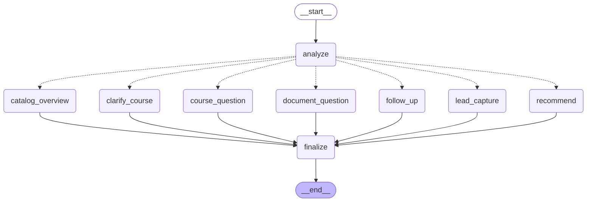

# REX AI — System Architecture (Sprint 2)

## Layers

| Layer | Modules | Responsibility |
|---|---|---|
| UI | `app.py`, `pages/1_Knowledge_Base.py`, `pages/2_Leads.py`, `src/ui_context.py` | Chat; admin upload/approve/remove PDFs; consented leads |
| Composition root | `src/bootstrap.py` | Creates and connects every component (dependency injection) |
| Agents | `src/agents/` (contract, registry, REX Assistant, prompts) | Conversation logic per agent |
| Workflows | `src/workflows/` | Learner-profile extraction, course scoring + explanations |
| Course catalog | `src/models/course.py`, `src/knowledge_base/` | Validated course schema, keyword course retrieval |
| RAG | `src/ingestion/`, `src/rag/` | PDF validation/extraction/chunking, embeddings, Chroma, passage retrieval |
| Services | `src/services/` | LLM (LangChain: Grok/Groq; Anthropic SDK), consent-based leads |
| Data | `src/db/`, `migrations/` | Shared SQLite database, repositories, Alembic migrations |
| Integration | `src/mcp_server/`, `src/mcp_client/` | `rex-academy` MCP server + client adapter |
| Evaluation | `evaluation/` | RAGAS evaluation, kept outside the request path |

## Agent 1 conversation graph (generated from the code with `graph_diagram()`)

- **analyze** makes a deterministic, testable routing decision (language, consent flow, course reference, question type, learner profile).
- **recommend / course_question / catalog_overview** answer from the approved *structured* course records.
- **document_question** answers from approved *PDF passages* with page citations, or says the documents do not contain the answer.
- **lead_capture** runs the consent flow; nothing is stored before "yes".
- **finalize** adds notes, language and the conversation state returned to the UI.
- The LLM (Grok/Groq via LangChain) only rewrites facts that were already retrieved. Any LLM failure falls back to the deterministic answer, labelled as such.

## Two kinds of knowledge

1. **Structured course records** (`courses` table): the only source of course facts (hours, tools, careers, fees...). Missing values stay `null` and are reported as "not available".
2. **Document passages** (approved PDFs): FAQs, accreditation statements, contact details, anything not in the structured record. Only **approved** documents are searched.

## How the other four agents reuse this

| Shared component | Reused by |
|---|---|
| `Agent` contract + `AgentRegistry` | every agent registers and is dispatched the same way |
| `courses` table + `CourseRepository` (or MCP `get_course`/`search_courses`) | Curriculum, Document Generation, Marketing read the same catalog — no copies |
| `PassageRetriever` / MCP `search_knowledge_base` | Curriculum (accreditation docs), Document Generation (templates) |
| `LLMService` (LangChain adapter) | every agent that generates text |
| `Database`, migrations, repositories | new tables (`curricula`, `generated_documents`, `rfp_opportunities`, `marketing_contents`) are added by migration and reference `courses.course_id` |
| LangGraph pattern (analyze → route → finalize) | each agent's workflow, and later the multi-agent orchestrator |
