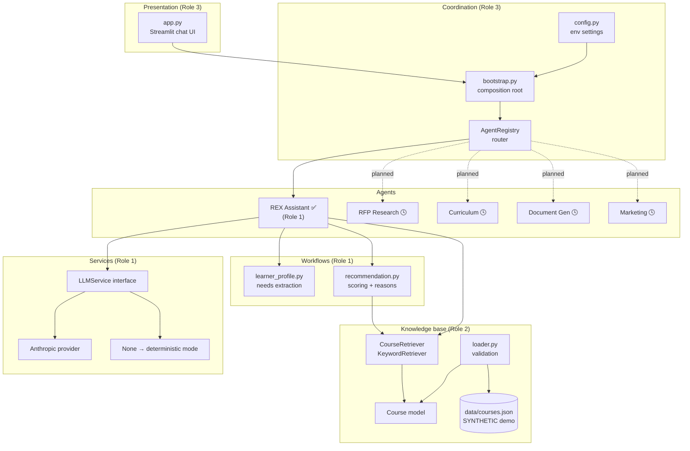
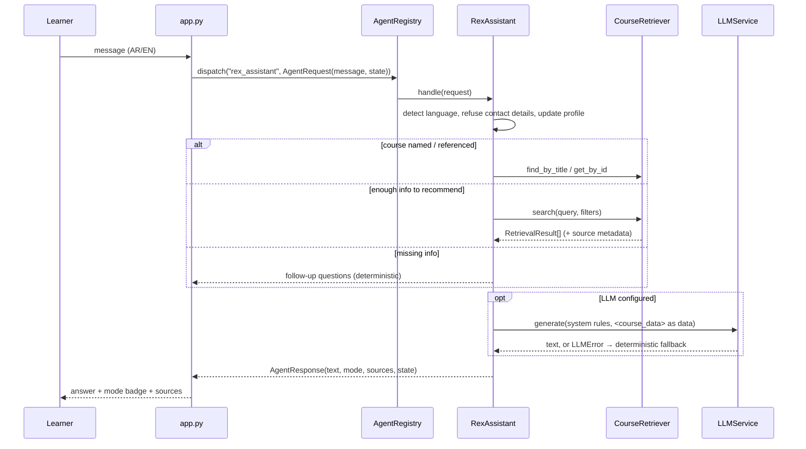

# REX AI — System Architecture (Sprint 1)

## Component diagram

## Request flow (one chat turn)

## Key design decisions

| Decision | Why | Upgrade path |
|---|---|---|
| Keyword retrieval with Arabic normalisation + bilingual synonyms | Small catalog, no infra, fully testable | Implement `CourseRetriever` with embeddings; assistant unchanged |
| Deterministic layer always computes the facts | Facts never depend on the LLM; app works without an API key | LLM only rewrites grounded facts |
| Structured match reasons (`Reason(code, facts)`) | Bilingual rendering, testable, safe LLM context | Add reason codes as rules grow |
| Topic follows the learner's latest statement | Avoids stale interests producing wrong recommendations | Add explicit "add to my interests" handling |
| State returned in `AgentResponse.state` | Agents stay stateless and testable | Persist state in SQLite for lead management |
| `ResponseMode` shown in UI | Never pass rule-based text off as LLM output | — |

## Out of scope for Sprint 1
Lead capture (needs a consent flow), embeddings/vector DB, the four other agents, deployment, CI.
