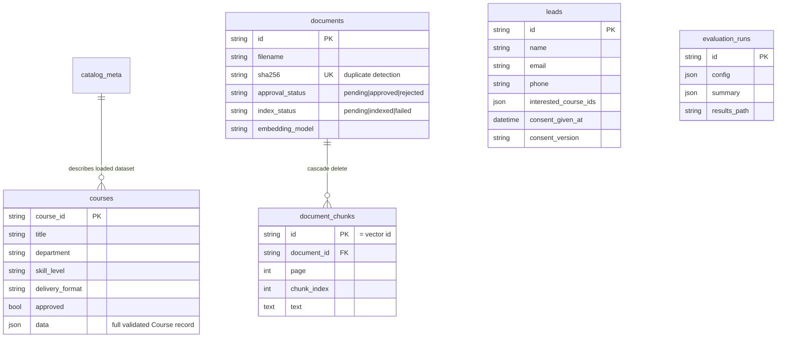
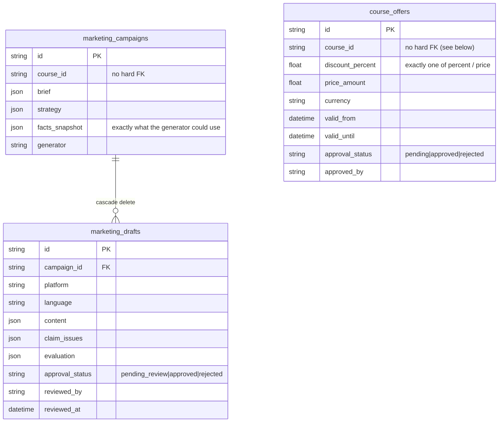

# Shared database schema

SQLite via SQLAlchemy 2, migrations with Alembic (`migrations/versions/0001_initial_shared_schema.py`).
The app migrates automatically at start-up; manually: `alembic upgrade head`.

**Why SQLite:** no server, one file, enough for a single-process Streamlit MVP and a three-person team.
Moving to PostgreSQL is a `DATABASE_URL` change (the models use portable types).

| Table | Owner today | Future users |
|---|---|---|
| `courses`, `catalog_meta` | Agent 1 | Curriculum, Document Generation, Marketing (read) |
| `documents`, `document_chunks` | knowledge base | Curriculum (standards), Document Generation (templates) |
| `leads` | Agent 1 (only after consent) | Marketing follow-up (human-approved) |
| `evaluation_runs` | evaluation | all agents' evaluations |

Planned (added by migration when each agent starts, referencing `courses.course_id`): `curricula`,
`generated_documents`, `rfp_opportunities`, `marketing_contents` (with `approval_status`).

**Rule:** only `src/db/repositories.py` reads or writes these tables.

## Agent 5 tables (migration `0003_marketing_and_offers`)

- `course_offers` is **shared**: REX Assistant (follow-up PR), the Marketing Agent and the MCP tool
  `get_active_offers` read it through `OfferService`, which returns only approved offers valid today.
  `courses.promotions` (free text) is never used as an offer.
- **No hard foreign key on `course_id`**: `CourseRepository.replace_catalog()` deletes and re-inserts all
  courses, which a FK would block or cascade-delete. Services validate the ids (same as `leads`).
- Downgrade to `0002` drops only these three tables; the RFP table stays (tested).
