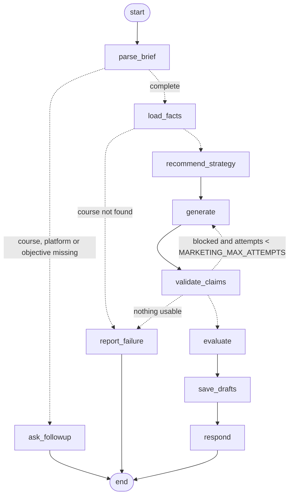

# Agent 5 — AI Marketing Agent

Generates multi-channel marketing campaigns **only from approved academy data**, checks every
claim, scores quality, and waits for a **named human reviewer**. It never publishes or sends anything.

> Analogy: a small advertising agency inside the academy. A clerk pulls the official course file
> (`CourseFactsProvider`), a planner picks platforms (`StrategyPlanner`), a copywriter drafts ads
> (`ContentGenerator`), a fact-checker crosses out anything not in the file (`ClaimValidator`), an
> editor scores quality (`MarketingEvaluator`), and a manager must sign before anything goes out
> (`ApprovalService`). LangGraph is the office workflow that passes the folder between them.

## 1. Brief requirements → implementation

| # | Requirement | Where | Proven by |
|---|---|---|---|
| 36 | Read approved course details | `src/marketing/facts.py` (`CourseFactsProvider`) | `test_marketing_rules.py` |
| 37 | Understand the target audience | brief `audience` or the course's approved `target_audience` | evaluator dimension 2 |
| 38 | Captions, FB/IG ads, LinkedIn, email, WhatsApp, headlines, CTA | `src/marketing/platforms.py`; every draft has headline, body, CTA (+ subject for email) | `test_marketing_agent.py` |
| 39 | Simple campaign strategy | `src/marketing/strategy.py` | `test_marketing_rules.py` |
| 40 | Multiple variations | `CampaignBrief.variations` (1–5, default 3) | `test_marketing_agent.py` |
| 41 | Connect with the Curriculum Agent | `CurriculumSource` interface; `NullCurriculumSource` until Agent 3 exists | fake curriculum test |
| 42 | Manual approval before sending/publishing | `src/services/approval_service.py`; no send/publish code exists | `test_no_publishing_or_sending_code_exists` |

**About requirement 41.** The Curriculum Agent is not built yet, so Agent 5 is *designed to
integrate* with it, not connected to it. When Agent 3 exists, a teammate implements one method,
`approved_curriculum(course_id)`, and plugs it in in `bootstrap.py`. Agent 5's code does not change.
Approved learning outcomes and modules then appear in the ads, each with its own source label.

## 2. Workflow (LangGraph) — generated from the code with `graph_diagram()`



| Node | What it does |
|---|---|
| `parse_brief` | Reads course, platforms, objective, audience, tone, language, variations, budget and any requested offer from the message (EN/AR, no LLM) and merges them with earlier turns. |
| `ask_followup` | Asks only for what is missing, listing the real courses, platforms and objectives. |
| `load_facts` | Loads the facts the copy may use. A requested offer that is not approved is reported and not used. |
| `recommend_strategy` | Platform order by objective, an angle per platform from facts that exist, a 3-phase sequence, notes on data gaps and budget. |
| `generate` | LLM first, deterministic templates on any failure. On a retry only the failing platforms are regenerated, with the checker's feedback. |
| `validate_claims` | Fact-checks every variation (Section 4). |
| `evaluate` | Drops variations that are still blocked, scores the rest on 8 dimensions. |
| `save_drafts` | Saves the campaign, its facts snapshot and the drafts, all `pending_review`, in one transaction. |
| `respond` | Strategy, drafts, scores, notes, and "Status: pending review. Nothing has been published or sent." |

## 3. Classes (OOP) and why each exists

| Class | File | Single responsibility |
|---|---|---|
| `CampaignBrief`, `CourseFacts`, `DraftVariation`, … | `src/marketing/models.py` | Data shapes only (Pydantic), no logic that touches LLMs or the DB |
| `Offer` | `src/models/offer.py` | A dated, measurable, approvable promotion (shared with Agent 1) |
| `PlatformSpec` | `src/marketing/platforms.py` | Per-platform rules used by both generation and evaluation |
| `BriefParser` | `src/marketing/brief_parser.py` | Text → brief, deterministic |
| `CourseFactsProvider` | `src/marketing/facts.py` | The **only** door for academy facts (course + curriculum + active offers) |
| `StrategyPlanner` | `src/marketing/strategy.py` | Rule-based plan, so it can never invent facts |
| `MarketingPromptBuilder` | `src/marketing/prompt_builder.py` | LangChain `ChatPromptTemplate`s |
| `LLMContentGenerator`, `TemplateContentGenerator` | `src/marketing/generator.py` | Two implementations of one `ContentGenerator` protocol |
| `ClaimValidator` | `src/marketing/claim_validator.py` | Deterministic fact-checker |
| `MarketingEvaluator`, `LLMJudge` | `src/marketing/evaluator.py` | Quality scores (deterministic) / optional model judge |
| `OfferService` | `src/services/offer_service.py` | Offer rules: only approved + currently valid offers are visible |
| `ApprovalService` | `src/services/approval_service.py` | Human review: edit, re-check, approve, reject |
| `OfferRepository`, `MarketingRepository` | `src/db/repositories.py` | The only classes that touch the new tables |
| `MarketingAgent` | `src/agents/marketing_agent.py` | The LangGraph workflow; implements the shared `Agent` contract |

Principles you can point to:
- **Dependency injection.** `MarketingAgent` receives its facts provider, repository, validator,
  evaluator and generator in the constructor. `bootstrap.py` is the only place that builds them, so
  tests pass fakes without patching.
- **Interfaces (protocols).** `ContentGenerator`, `CurriculumSource` and `OfferReader` let one
  implementation replace another (LLM ↔ templates, null ↔ real curriculum, direct ↔ MCP offers).
- **Composition over inheritance.** The agent *has* a validator and a generator; nothing inherits
  from Agent 1.
- **Separation.** No SQL in the agent, no prompts in logic, no business rules in the Streamlit pages.

## 4. The fact-checker (`ClaimValidator`)

It finds **claims** in the text and checks each one against `CourseFacts`. It handles Arabic
normalization (أ/ا, ة/ه, ى/ي), Arabic digits (٢٠٠٠), and Arabic prefixes glued to words (بشهادة).

| Claim in the ad | Allowed only if |
|---|---|
| price (`2,000 EGP`, `٣٠٠٠ جنيه`, `300$`) | it equals the approved fee, an offer price, or the fee after an approved discount |
| percent (`20%`, `٢٠٪`) | it equals an approved, active offer |
| discount words (`special offer`, `خصم`, `عرض خاص`) | an approved, active offer exists |
| dates and start words | schedule/offer data exists (then a warning), otherwise blocked; an offer's own dates are verified |
| hours, weeks, months | they match `duration_hours` / `duration_text` |
| online / in person / hybrid | they match `delivery_format` |
| "certificate" / شهادة | the data mentions a certificate (all official tracks list an ITI Completion Certificate) |
| "accredited", "certified", "diploma" / معتمد | the data uses that word (TRK-003's "Certification Preparation") |
| instructors / trainers | instructor data exists |
| "no experience needed" / بدون خبرة | the level is beginner or all levels |
| job guarantees, "#1", "best academy in" | **never** |
| vague superlatives ("best") | warning only |

A **block** prevents approval. A **warn** is shown to the reviewer.

## 5. LangChain vs LangGraph

- **LangChain is the toolbox:** model connection (`ChatGroq`/`ChatXAI` through the existing
  `LangChainChatService`), `ChatPromptTemplate`, and `with_structured_output(LLMDraftSet)` so the
  model returns typed data instead of free text.
- **LangGraph is the assembly line:** which step runs next, the retry loop, stopping to ask a question.
- **Fallback order inside `LLMContentGenerator`:** structured output → plain call with JSON
  instructions, validated by Pydantic → `GenerationError`. The agent then uses templates, so a
  provider outage never breaks a demo.

## 6. MCP

| Capability | How Agent 5 gets it |
|---|---|
| course records | existing `CourseRetriever` protocol: `KeywordRetriever` (direct) or `McpCourseRetriever` (`COURSE_BACKEND=mcp`) |
| active offers | **new read-only tool** `get_active_offers(course_id)` on `rex-academy`, read by `McpOfferReader` over the same connection |
| save drafts, approve, propose offers | **not** MCP: consequential writes stay in the app, following the existing server rule |

`tests/test_marketing_mcp.py` starts the MCP server as a **separate process** and runs Agent 5
over it. A pending 50% offer stays invisible; the approved 15% offer is seen.
If the offer source fails, the agent continues **without offers** and says so in its notes, so a
network problem can never produce ads with unverified discounts.

## 7. Database (migration `0003`, after the RFP migration `0002`)

| Table | Purpose |
|---|---|
| `course_offers` | approved, dated offers, shared by Agent 1, Agent 5 and MCP |
| `marketing_campaigns` | brief, strategy, **facts snapshot** (exactly what the generator was allowed to use), generator |
| `marketing_drafts` | one row per variation: content, claim issues, evaluation, `pending_review`/`approved`/`rejected`, reviewer, time, note |

`course_id` has **no hard foreign key** in the first two tables. `replace_catalog()` deletes and
re-inserts every course, so a hard foreign key would either wipe the offers or block reseeding. The
services validate course ids instead, the same pattern as `leads.interested_course_ids`. This is
tested in `test_offers_survive_a_catalog_reseed`. Drafts do have a cascading foreign key to their campaign.

## 8. Human approval (requirement 42)

- Drafts start `pending_review`. Approve and reject need a **reviewer name**, which is stored with the time.
- **Approval re-checks against today's data**, not the generation snapshot, so an expired offer or a
  changed fee blocks approval.
- **Editing** re-runs the fact-checker and sends the draft back to `pending_review`.
- **There is no publish or send method anywhere.** "Approved" means a person may copy the text out
  (the Approved tab shows a copy box). A test fails if a publish/send-style method appears on the agent,
  the repository or the approval service, or if the approval service imports an email or HTTP library.

## 9. Evaluation

Script: `evaluation/marketing/run_marketing_eval.py`. Each run uses its own temporary database, and
results are saved as JSON and CSV and recorded in `evaluation_runs` with `kind="marketing"`.

```bash
python -m evaluation.marketing.run_marketing_eval --label baseline                # free, offline
python -m evaluation.marketing.run_marketing_eval --label groq --llm --pause 2    # Groq generation (API calls)
python -m evaluation.marketing.run_marketing_eval --label groq-judged --llm --judge --pause 2
python -m evaluation.marketing.run_marketing_eval --compare evaluation/marketing/results/<A> evaluation/marketing/runs/<B>
```

**Two parts, measured separately** (like retrieval vs generation in RAG):
1. **Campaigns** (`dataset.jsonl`, 20 cases: 14 EN, 6 AR). Normal requests plus traps: unapproved
   discount (EN and Arabic digits), accreditation and job guarantee, a request that conflicts with the
   data (60 h online vs 100 h unknown format), missing data (TRK-003 has no duration or fee), prompt
   injection, an incomplete request, an unknown course, an unknown course id, and an approved 15% offer.
   Each trap lists **forbidden** strings that must never appear in the output.
2. **Fact-checker** (`checker_cases.jsonl`, 30 hand-labelled texts). Includes 5 paraphrases the rules
   are **expected to miss**, so the recall figure is honest.

**Dimensions (0–1).** factual accuracy and unsupported claims are hard gates (they must be 1);
audience relevance is measured only when the audience and the copy are in the same language; then
objective alignment, completeness, CTA quality, language, and platform formatting. A draft passes
when both gates are 1 and the mean is at least `MARKETING_PASS_THRESHOLD` (0.7, a starting value).

### Measured results (2026-10-24, base commit `e8c17b0` + the uncommitted Agent 5 changes, deterministic templates, no LLM)

| Metric | Baseline | After the two fixes below |
|---|---|---|
| Campaign outcome accuracy (campaign / follow-up / error as expected) | 0.95 (19/20) | **1.0** (20/20) |
| Language accuracy | 1.0 | 1.0 |
| Drafts produced | 61 | 64 |
| Draft pass rate | 1.0 | 1.0 |
| Trap cases without any forbidden string | 9/9 | 9/9 |
| Gate violations shown to the user | 0 | 0 |
| Checker exact match | 0.80 | **0.833** |
| Checker micro precision | 0.944 | **1.0** |
| Checker micro recall | 0.773 | 0.773 |

Results: `evaluation/marketing/results/20261024-125439_baseline-deterministic/` and
`.../20261024-125508_after-parser-fixes/`.

**Failures found by the baseline, and the fixes**
- `ar-04` asked a follow-up instead of generating. "لجمع **ال**عملاء **ال**محتملين" puts the Arabic
  article on both words; the pattern expected "عملاء محتملين". Fixed the pattern and added a regression test.
- `c03` "Get 25% off" was reported twice (discount *and* offer) because `% off` was also in the
  discount-words list. Removed it; the percent rule already covers it.

**Remaining checker misses (known limits, not fixed by more regex):** an amount in words ("two
thousand pounds"), a discount without the word ("save a third"), an implied guarantee ("your new
job is waiting"), a paraphrase of online ("from your living room"), and a vague recognition claim
("recognized by employers"). The optional LLM judge (`--judge`) is the planned second line of defence.

**How to read these numbers.** The baseline uses deterministic templates that are built from
approved facts by construction, so their perfect dimension scores show the **pipeline and the
safety net work**, not that the copy is creative. The meaningful test of an LLM is the `--llm` run:
it shows whether the model invents claims and how often the retry loop and the drop rule are needed.
**That run has not been done yet (it needs `GROQ_API_KEY`), and no LLM score is reported here.**

**Cost.** The baseline is free. `--llm` makes about one call per platform per case, plus retries;
`--judge` adds one call per draft. On Groq's free tier, use `--pause` to stay within rate limits.
The judge is itself a model and can be wrong; treat judged scores as indicative.

## 10. Run it

```bash
streamlit run app.py            # sidebar → Marketing / Offers (protected by ADMIN_PASSWORD if set)
python -m pytest tests/test_marketing_*.py -v
```

Settings (`.env`): `MARKETING_MAX_ATTEMPTS=2`, `MARKETING_PASS_THRESHOLD=0.7`, plus the existing
`LLM_PROVIDER`, `GROQ_API_KEY`, and `COURSE_BACKEND`. With `LLM_PROVIDER=none` everything works offline.

Manual check:
1. Offers page: propose a 15% offer for TRK-002. Generate a WhatsApp campaign: no discount appears.
   Approve the offer, generate again: "Offer: … 15% (until …)" appears.
2. Marketing page: generate a LinkedIn campaign for TRK-001. Review tab: edit a body to "only 1500 EGP"
   and click "Save edits & re-check": a price block appears and Approve is disabled. Remove the text,
   save, then approve with your name. The Approved tab shows who approved it and when.
3. Chat-style (Python): `ctx.registry.dispatch("marketing", AgentRequest.from_text("I need a campaign"))`
   asks for the missing course, platform and objective.

## 11. Known limitations
- The official catalog has no fees, schedules, instructors, format or level, and only 1/5 tracks has
  learning outcomes. Ads are correct but less specific until the academy provides this data.
- Regex claim detection misses paraphrases (Section 9). Deterministic audience relevance cannot
  compare Arabic copy with an English audience; that case is reported as "not measured", not as a score.
- Course names in Arabic must match the official Arabic title. Otherwise the agent asks which course
  is meant (safer than guessing).
- Structured output on Groq `openai/gpt-oss-120b` is verified offline (the API exists) but **not
  yet verified live**. The shared `max_tokens=1024` may truncate long Arabic sets; the JSON fallback
  and templates cover that case.
- Platform limits are team guideline values, not official platform limits.
- Agent 1 does not read `course_offers` yet; that is a separate small follow-up PR.
