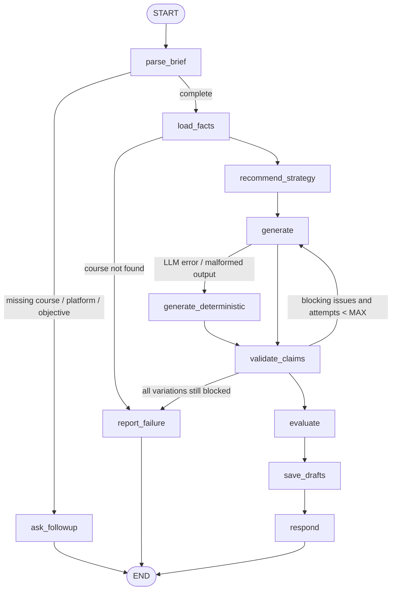

# Agent 5 — Marketing Agent: Design (Phase 2)

Status: **implemented — this was the Phase 2 proposal; see `docs/marketing_agent.md` for the final design.** Every claim about existing code below was
verified against `main` @ `e8c17b0` (119 tests passing). Nothing here is a measured result.

## 1. Requirements traceability

| Brief # | Requirement | Design element |
|---|---|---|
| 36 | Read approved course details | `CourseFactsProvider` → existing `CourseRetriever` (direct or MCP `get_course`) |
| 37 | Understand target audience | `CampaignBrief.audience`, default = course `target_audience` |
| 38 | Captions, FB/IG ads, LinkedIn, email, WhatsApp, headlines, CTA | `Platform` enum + `PlatformSpec`; every variation has headline, body, CTA |
| 39 | Simple campaign strategy | `recommend_strategy` node → `StrategyPlan` |
| 40 | Multiple variations | `CampaignBrief.variations` (default 3), one angle per variation |
| 41 | Connect with Curriculum Agent | `CurriculumSource` interface; `NullCurriculumSource` until Agent 3 exists |
| 42 | Manual approval before sending/publishing | `ApprovalService`; drafts start `pending_review`; no send/publish code exists |
| Agent 1 + 5 | "Pricing and promotions", "What offer should be included?" | Shared `course_offers` table + `OfferService` (used by both agents) |

## 2. Big picture

```
            Streamlit (chat + pages/4_Marketing.py)
                          │
                    AgentRegistry ── dispatch("marketing", AgentRequest)
                          │
                   MarketingAgent  (LangGraph workflow)
     ┌──────────┬─────────┼──────────────┬──────────────┬──────────────┐
CourseFacts  Marketing  ContentGenerator  ClaimValidator  Marketing    Marketing
Provider     PromptBuilder (LangChain)    (deterministic) Evaluator    Repository
  │   │   │
  │   │   └── OfferService ── course_offers          (shared, also used by Agent 1)
  │   └────── CurriculumSource (Null today, Agent 3 later)
  └────────── CourseRetriever (KeywordRetriever | McpCourseRetriever → rex-academy MCP)
```

Rule: **academy facts flow in only through `CourseFactsProvider`.** The LLM never receives
facts from anywhere else, so every fact in an ad can be traced to a source reference.

## 3. Data models (Pydantic, `src/marketing/models.py`)

| Model | Fields (main) |
|---|---|
| `Platform` (enum) | `social_caption`, `facebook`, `instagram`, `linkedin`, `email`, `whatsapp` |
| `CampaignObjective` (enum) | `awareness`, `lead_generation`, `enrollment`, `re_engagement` |
| `CampaignBrief` | course_id, platforms[], objective, audience, language (`en`/`ar`), tone, variations (1–5), budget_note (optional), requested_offer (optional, user text — untrusted) |
| `Fact` | field, value, source: `SourceReference` |
| `CourseFacts` | course_id, title, title_ar, facts[], missing_fields[], active_offers[] |
| `StrategyPlan` | platform_order[], angle_per_platform{}, sequence[] (e.g. awareness → details → reminder), notes |
| `DraftVariation` | platform, language, headline, body, cta, hashtags[], email_subject (email only), angle |
| `ClaimIssue` | variation_index, kind, text_span, severity (`block`/`warn`), explanation |
| `DimensionScore` | dimension, score 0–1, method (`deterministic`/`judge`), reason |

`CampaignBrief` required fields: **course, at least one platform, objective.** Language defaults to
the message language, audience to the course's `target_audience`, tone to the platform default,
variations to 3. Budget is campaign input only: it shapes the strategy, never the ad text.

## 4. Database (migration `0003_marketing_and_offers`)

Adds three tables, changes no existing table, preserves all data.

**`course_offers`** (shared — Agent 1 and Agent 5)

| Column | Notes |
|---|---|
| id | uuid |
| course_id | FK → `courses.course_id` |
| title_en, title_ar | e.g. "Early-bird discount" |
| discount_percent / price_amount + currency | one of them; validated |
| valid_from, valid_until | dates; outside this window the offer is never used |
| approval_status | `pending` / `approved` / `rejected` (reuses `ApprovalStatus`) |
| proposed_by, approved_by, approved_at, created_at | audit trail |

**`marketing_campaigns`**: id, course_id (FK), brief (JSON), strategy (JSON), facts_snapshot (JSON —
the exact facts given to the LLM, for traceability), generator (`llm:<model>` or `deterministic`),
created_at.

**`marketing_drafts`**: id, campaign_id (FK, cascade), variation_index, platform, language, content
(JSON `DraftVariation`), claim_issues (JSON), evaluation (JSON), approval_status
(`pending_review`/`approved`/`rejected`), reviewed_by, reviewed_at, review_note, edited (bool), created_at.

Why `facts_snapshot`: course data can change after a campaign is generated. The snapshot proves
which facts the draft was based on.

## 5. Lifecycles

```
Offer:  pending ──admin──► approved ──(date passes)──► treated as expired (computed, not stored)
                    └────► rejected
Draft:  pending_review ──admin approves (no blocking issues)──► approved ──► copied/exported by a human
                     └──admin rejects──► rejected
        admin edits text ──► ClaimValidator runs again ──► stays pending_review
```

There is **no "published" state and no sending code.** Distribution is a human copying approved
text. Principle for reviewers: *if an ad needs a fact the data lacks, fix the data, not the ad.*

## 6. Interfaces

```python
class CurriculumSource(Protocol):
    def approved_curriculum(self, course_id: str) -> CurriculumFacts | None: ...

class NullCurriculumSource:            # used until Agent 3 exists
    def approved_curriculum(self, course_id: str) -> None: return None

class OfferService:
    def active_offers(self, course_id: str, on: date | None = None) -> list[Offer]   # approved + valid only
    def propose(self, course_id: str, text: str, proposed_by: str) -> str            # saved as pending
    def approve(self, offer_id: str, approver: str) -> None
    def reject(self, offer_id: str, approver: str) -> None

class CourseFactsProvider:
    def __init__(self, courses: CourseRetriever, curriculum: CurriculumSource, offers: OfferService): ...
    def facts_for(self, course_id: str) -> CourseFacts      # raises CourseNotFoundError
```

Merge rule: course record first; approved curriculum adds learning outcomes and modules; each
`Fact` keeps its own source reference. Conflicts are reported in `missing_fields`/notes, not guessed.

## 7. LangGraph workflow (`MarketingAgent`)



`MarketingState` (TypedDict): message, lang, brief, missing[], facts, strategy, variations[],
issues[], attempts, scores[], campaign_id, response.

- **parse_brief** — deterministic extraction (like `learner_profile.py`) merged with the brief
  stored in `AgentRequest.state`, so the user is never asked twice. If the user names an offer that
  is not approved, it is saved via `OfferService.propose` and the reply says it needs approval.
- **validate_claims → generate** retry sends the issues back as feedback. `MAX_ATTEMPTS = 2`
  (configurable). Variations that still fail are dropped and reported.
- **evaluate** runs the cheap deterministic checks in production; the LLM judge runs only in the
  offline evaluation script (Section 10).
- Every node is a method that takes and returns state, so each can be unit-tested alone.

## 8. LangChain usage

- `MarketingPromptBuilder` builds `ChatPromptTemplate`s. Course facts go inside `<course_data>`
  marked as data, never as instructions (same rule as Agent 1's `prompts.py`).
- `ContentGenerator` calls `chat_model.with_structured_output(MarketingDraftSet)` on
  `LangChainChatService.chat_model`. Verified offline: the installed `ChatGroq` supports
  `function_calling`, `json_schema` and `json_mode`. **Not yet verified:** that
  `openai/gpt-oss-120b` on Groq returns valid output at runtime (Phase 5, needs `GROQ_API_KEY`).
- Fallback chain: structured output → plain `generate()` + JSON parse + Pydantic validation →
  deterministic templates. With `LLM_PROVIDER=none` the agent is fully demoable offline.
- Tests use LangChain's `GenericFakeChatModel`, so no test needs an API key.

LangChain = the toolbox (model, prompts, typed output). LangGraph = the assembly line (order of
steps, retries, stopping to ask). They work at different levels.

## 9. ClaimValidator rules (deterministic)

| Claim found in ad text (EN + AR) | Allowed only if |
|---|---|
| price / currency amount | equals approved `fee` or an active offer price |
| percent / "discount" / "خصم" / "عرض" | matches an active approved offer |
| date, "starts", "يبدأ" | matches `schedule` or offer validity |
| hours / weeks | consistent with `duration_hours` / `duration_text` |
| "online", "in person", "أونلاين", "حضوري" | matches `delivery_format` |
| "certified", "accredited", "certificate", "شهادة", "معتمد" | present in course or curriculum facts |
| instructor names | match `instructor` |
| "guaranteed job", "ضمان وظيفة", "best in Egypt", "#1" | **never allowed** |

Severity `block` stops approval; `warn` (e.g. vague superlatives) is shown to the reviewer.

## 10. Evaluation (`evaluation/marketing/`)

Each dimension scores 0–1. Thresholds below are starting values to be calibrated on the
baseline run — they are not results.

| # | Dimension | Method |
|---|---|---|
| 1 | Factual accuracy | deterministic (ClaimValidator) — **hard gate: must be 1** |
| 2 | Audience relevance | deterministic term overlap + judge |
| 3 | Objective alignment | deterministic CTA-type check + judge |
| 4 | Completeness | deterministic: required elements per platform present |
| 5 | CTA quality | deterministic (present, one clear action) + judge |
| 6 | Tone and language | deterministic language detection + judge for tone |
| 7 | Platform formatting | deterministic `PlatformSpec` checks |
| 8 | No unsupported claims / invented offers | deterministic — **hard gate: must be 1** |

Dataset (`dataset.jsonl`): AR and EN requests across all platforms and objectives, plus traps —
requests for unapproved discounts, accreditation claims, missing course, conflicting data.
`run_marketing_eval.py` writes the same run-folder format as RAGAS (`config.json`, `scores.csv`,
`summary.json`, `samples.jsonl`) and records the run in `evaluation_runs` with `kind="marketing"`.
The judge is optional (`--judge`) and uses the configured provider; on Groq's free tier it is
rate-limited, so the script throttles and caches.

## 11. MCP

- **Reuse:** Agent 5 reads courses through the existing `CourseRetriever` protocol, so with
  `COURSE_BACKEND=mcp` it uses `McpCourseRetriever` (real stdio connection, tested fallback) with
  no new client code. Allowed tools per `docs/mcp.md`: `list_courses`, `get_course`.
- **New read-only tool:** `get_active_offers(course_id)` on `rex-academy`, returning only approved,
  currently valid offers. Usable by Agent 1, Agent 5 and future agents.
- **Not exposed over MCP:** proposing/approving offers, saving or approving drafts. These are
  consequential writes and stay in-app, following the existing server rule.
- **Later (Agent 3):** `get_approved_curriculum(course_id)`, implemented behind `CurriculumSource`.

## 12. Files

New: `src/marketing/{__init__,models,platforms,prompt_builder,generator,claim_validator,evaluator,facts}.py`,
`src/agents/marketing_agent.py`, `src/services/{offer_service,approval_service}.py`,
`migrations/versions/0003_marketing_and_offers.py`, `pages/4_Marketing.py`,
`evaluation/marketing/{dataset.jsonl,run_marketing_eval.py}`, tests, `docs/marketing_agent.md`.

Edited (additions only): `src/db/models.py`, `src/db/repositories.py`, `src/bootstrap.py`,
`src/mcp_server/academy_server.py` (one tool), `src/config.py` (marketing settings), docs.

Agent 1 (`rex_assistant.py`) is **not** changed in this work. Reading offers in Agent 1 is a
separate, small follow-up PR.

## 13. Implementation order

| Phase | Deliverable | Verified by |
|---|---|---|
| 3a | Models, `PlatformSpec`, migration 0003, repositories | migration up/down test, repository tests |
| 3b | `OfferService`, `ApprovalService`, `CourseFactsProvider`, `NullCurriculumSource` | unit tests incl. expired/pending offers, approval gate |
| 3c | `ClaimValidator` | AR + EN unit tests for every rule |
| 4 | `get_active_offers` MCP tool; Agent 5 over MCP | real stdio test, unavailable-server fallback |
| 5 | Prompt builder, generator, LangGraph workflow, registry, UI page | fake-model tests for every edge; live Groq smoke test |
| 6 | Evaluator + dataset + script | baseline run with real measured scores |
| 7 | Bug fixes, docs, full suite | `pytest` full run reported as-is |

## 14. Risks and limits

- Today 0/5 courses have fees, offers, schedule, instructor, format or level, and only 1/5 has
  learning outcomes. Ads will be correct but less specific until the academy provides data.
- Regex claim detection can miss paraphrased claims; the judge in offline evaluation covers part
  of this gap. Documented, not hidden.
- Arabic tone quality depends on the model; measured in Phase 6, not assumed.
- Groq free-tier rate limits affect evaluation speed, not correctness.
- `ADMIN_PASSWORD` gating is MVP-level protection, not real authentication.

## 15. Changes made during implementation
- **No hard FK on `course_id`** in `course_offers` and `marketing_campaigns` (reseeding replaces all courses).
- **The chat does not save offers.** An unapproved offer in a request is reported and ignored; offers are
  added only on the Offers page, with dates and a percent or price.
- **The LLM → template fallback lives inside the `generate` node**, per platform, instead of a separate node.
- **Accreditation rule split:** "certificate" is allowed when the data lists one; "accredited/certified/
  diploma" only when the data uses that word.
- **Templates include approved offers**, and an offer's own dates are treated as verified.
