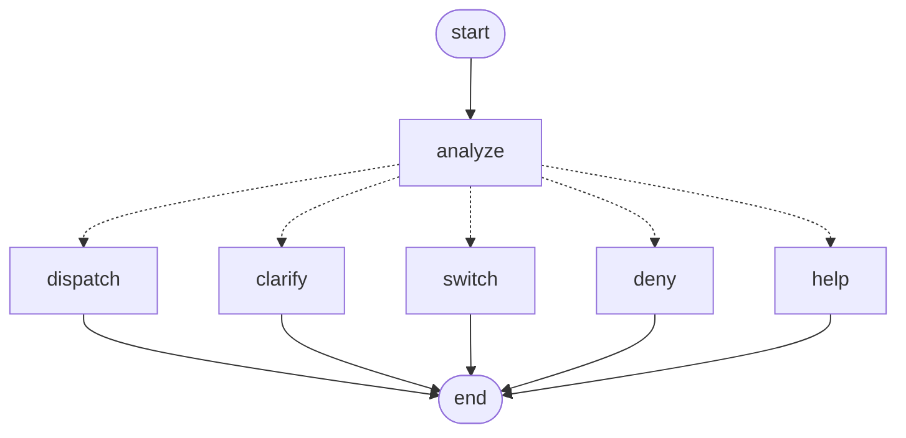

# Agent Orchestrator / Router

The project brief (section 4) puts one component between the interface and the agents:

    User / Admin interface  ->  REX AI Agent Orchestrator / Router  ->  5 specialised agents

`src/agents/orchestrator.py` is that component. The main chat (`app.py`) sends **every** message
to `OrchestratorAgent`; it decides which agent answers and forwards the message unchanged.

## Responsibilities (and what it does NOT do)

| Does | Does not |
| --- | --- |
| Pick the agent for each message (English and Arabic) | Answer questions itself or contain business logic |
| Keep each agent's conversation state separate | Approve, publish or send anything |
| Enforce who may use which agent (students vs staff) | Replace the admin pages (review/approval stays there) |
| Ask the user when a request fits two agents | Guess silently when it is unsure |
| Keep the chat alive if one agent fails or is unavailable | Log message text (it may contain contact details) |

## Classes

- **`IntentRouter`**: pure, deterministic bilingual keyword scoring. No I/O and no LLM, so it is free,
  instant and fully unit-tested. Each rule is `(agent, weight, pattern)`: 3 = a record ID
  (`RFP-…`, `CUR-…`, `DOC-…`), 4 = a document name, 2 = a strong phrase, 1 = a hint. Hints
  alone never move the conversation (e.g. "digital marketing" is a course, not a campaign).
- **`OrchestratorAgent`**: implements the shared `Agent` contract and runs a LangGraph workflow,
  the same pattern as Agents 1 and 5. `response.agent_name` names the agent that really answered;
  `response.data["routing"]` explains the decision (`action`, `agent`, `reason`, `scores`).
- **`Agent.expects_reply(state)`** (new, optional, default `False`): an agent says "the next
  message is mine". REX returns `True` while it collects consent or contact details.


(Generated from the code with `OrchestratorAgent(...).graph_diagram()`.)

## Routing order (first rule that applies wins)

1. `/help` or `/agents` lists the agents this user may use.
2. If a clarifying question is open and the user answers `1`, `٢` or an agent name, the
   **original** request goes to that agent.
3. Explicit command: `/rex`, `/rfp`, `/curriculum`, `/documents`, `/marketing` (optionally followed
   by text), `switch to marketing`, `حولني للتسويق`.
4. The active agent is waiting for this user's reply (`expects_reply`), e.g. REX lead capture.
5. A strong keyword signal for exactly one agent. A tie with the active agent stays with it;
   any other tie asks the user (e.g. "generate the curriculum PDF", which both the Curriculum and
   Document agents can do).
6. Otherwise the active agent continues (follow-up answers such as "Arabic, for fresh graduates").
7. Otherwise **REX Assistant**, the student-facing default.

## Permissions

`handle(request, allowed_agents=...)` defaults to the public agents only (REX): least privilege.
The UI passes all agents only after the staff sign-in in the sidebar (the same `ADMIN_PASSWORD`
and session flag as the admin pages). A student's tender or campaign question therefore goes to
REX; an explicit `/marketing` gets a polite refusal. Approval of curricula, documents and
marketing drafts still requires a named reviewer on the admin pages.

## State

```json
{"active": "marketing", "pending": null,
 "agents": {"rex_assistant": {...}, "marketing": {"brief": {...}}}}
```
Each agent only ever receives its own entry, so switching to the RFP agent and back resumes the
marketing brief exactly where it was.

## Errors

| Situation | Behaviour |
| --- | --- |
| Agent not registered (failed at start-up) | "…is not available right now", mode `error`, state kept |
| Agent raises an exception | logged with stack trace; friendly error; other agents' state kept |
| Unknown command (`/foo`) | help text |

## How to try it

```bash
streamlit run app.py
```
Student mode: ask "Any education tenders in Egypt?" and REX answers. Sign in as staff in the
sidebar, then try in one conversation: `I want to become a software tester`,
`Any education tenders in Egypt?`, `create a curriculum for TRK-001`,
`generate a participant guide for TRK-001`, `write a LinkedIn campaign for TRK-001`.
The caption under each answer shows the agent and the reason, e.g. `→ RFP & Tender Research (keywords)`.

Tests: `pytest tests/test_orchestrator.py tests/test_app_ui.py`.

## Limitations / next steps

- Keyword rules cover the phrasings in the tests; unusual wording falls back to the active agent
  or REX. An optional LLM classifier can be injected for uncertain cases later.
- Multi-step workflows across agents (e.g. curriculum approved → marketing campaign) are the next
  step: the orchestrator is where they will be coordinated.
