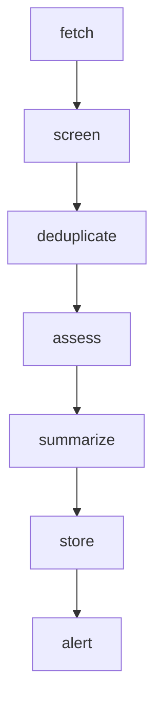

# Agent 2 — Educational RFP & Tender Research

Finds education and training tenders (RFPs, RFQs) in **Egypt** and **Saudi Arabia only**, extracts the
key facts, removes anything out of scope, expired or duplicated, gives a first "may the academy
qualify?" assessment, and stores the result in the shared database for the dashboard and the chat.

## What it does (brief requirements → where)

| Requirement | Where |
|---|---|
| Search approved sources | `src/rfp/worldbank.py` — **live World Bank Procurement Notices API** (real notices); `src/rfp/sources.py` — `TenderSource` protocol + `JsonFileSource` feed file |
| Read the real notice documents | `src/rfp/documents.py` — notice HTML → text; requirement sentences and the deadline read from the document when not given as fields |
| Identify training categories (6 from the brief) | `extraction.classify()` — bilingual keyword rules |
| Extract title, organization, country, deadline, eligibility, category, link, publication date, documents | `extraction.extract()` → `Opportunity` |
| **Strict Egypt / Saudi filter** | `extraction.detect_country()` + `screening.screen()` |
| Filter unrelated and expired | `screening.screen()` |
| Detect duplicates | `screening.DuplicateDetector` (same link, or same organization + ≥ 88 % similar title) |
| Short AI summary | `summary.py` — deterministic; optional LLM rewrite of the same facts (`RFP_LLM_SUMMARIES=on`) |
| Assess whether the academy may qualify | `qualification.assess()` — catalog topic match + requirements to verify |
| Store in a searchable dashboard | `rfp_opportunities` table (migration 0002) + `pages/3_RFP_Opportunities.py` (filters, search, CSV export for Excel / Google Sheets) |
| Alerts for new relevant RFPs | new **Egypt** opportunities are flagged and listed as alerts on scan, in chat and on the dashboard |
| **Business rule:** Egypt → immediate review; Saudi → monitored | `screening.initial_status()` |

## Scan pipeline (LangGraph)

| Step | Does |
|---|---|
| fetch | reads every source; a missing or broken feed is reported, never crashes the scan |
| screen | extracts fields, then applies the rules **in order**: market → training-related → not expired. Each excluded listing gets exactly one reason |
| deduplicate | against the database and inside the batch; the same tender seen again is *refreshed*, a re-post is *excluded* |
| assess | fit = strong / possible / weak with reasons (never "qualifies") |
| summarize | deterministic summary; LLM only rewrites, and is rejected if it drops the deadline |
| store | upsert by `dedup_key`; human decisions (reviewed / dismissed) are never overwritten; past deadlines become `expired` |
| alert | new Egypt opportunities → alerts, `alerted_at` set so they are not re-alerted |

## Rules in detail

**Country (strict).** An explicit country field wins (`Egypt`, `مصر`, `KSA`, `المملكة العربية السعودية`…).
Without one, cities (Cairo, الإسكندرية, Riyadh, جدة…) and government domains (`.gov.eg`, `.gov.sa`) decide.
Both markets mentioned, or neither → `UNKNOWN` → excluded. Any other country → excluded.

**Training-related.** Category words alone are not enough: "Supply of IT hardware" mentions IT but is not
training. A listing must also contain a training signal (training, courses, upskilling, تدريب, دورات, تأهيل…).

**Dates.** ISO, `dd/mm/yyyy` (day-first, as used in both markets), `Nov 15, 2026`, Arabic month names and
Arabic-Indic digits. Hijri dates are **not converted** in the MVP: the deadline is shown as unknown, never guessed.

**Fit.** STRONG = topic matches an academy track, requirements are published and none needs checking.
POSSIBLE = match but something to verify (registration, licence/TVTC, ISO, years of experience, bank
guarantee, Saudization, similar projects) or requirements unpublished; or general training with no track.
WEAK = no track match and requirements to verify. The text always says it is a first assessment.

## Use it
- Dashboard: sidebar → **RFP Opportunities** → *Run scan*. Review an opportunity, mark it reviewed or dismissed, export CSV.
- Chat: `scan` · `egypt` · `saudi` · `RFP-1A2B3C`, or in Arabic `ابحث` · `مصر` · `السعودية`.
- Settings: `RFP_SOURCES=worldbank,file` (default: both), `RFP_FEED_PATH` (the feed file; default: the synthetic demo feed),
  `RFP_WORLDBANK_ROWS` (newest notices per country, default 100), `RFP_HTTP_TIMEOUT_SECONDS` (20), `RFP_LLM_SUMMARIES=on|off` (off).

## Data

### Real tenders: World Bank Procurement Notices API
`GET https://search.worldbank.org/api/v2/procnotices?format=json&fl=*&project_ctry_name_exact=<country>`, free,
no API key, data under CC BY 4.0. Each notice is an official procurement notice for a World Bank-financed project,
published by the borrowing government (e.g. an Egyptian ministry), and includes the **full notice document** (HTML).

- Queried for `Egypt, Arab Republic of` and `Saudi Arabia`, newest first.
- **Contract-award notices are skipped**: they announce who already won, so they are not opportunities.
- Classification uses the title and the short description; the **full document** is read separately for
  requirements and the deadline, so a goods tender that only mentions "training of operators" is not kept.
- Each kept notice links to `https://projects.worldbank.org/en/projects-operations/procurement-detail/<id>`.
- **Coverage, honestly:** Egypt has World Bank notices, but only a few are open training calls at any time, so a
  scan may keep 0–3. The World Bank does not lend to Saudi Arabia, so the Saudi query normally returns 0.
- If the API cannot be reached (no internet), the scan reports it and continues with the other sources.

### Why not Etimad or Egypt's e-tenders portal?
Saudi Etimad's API requires a Saudi commercial registration and a paid subscription; Egypt's portal has no public
API. Both can be added later as new `TenderSource` classes once access exists.

### Demo feed (kept as a second source)
`data/rfp/sample_tenders.json` is a **synthetic** feed: invented organizations (marked "fictional") and
`example.com` links, built so every rule is exercised. It is labelled synthetic in the feed, the database,
the chat and the dashboard. To use real listings: export them into the same JSON shape and set
`RFP_FEED_PATH`, or add a new `TenderSource` class. Nothing else changes.

## Tests (`python -m pytest tests/test_rfp_*.py`)
| File | Covers |
|---|---|
| test_rfp_extraction.py | date formats incl. Arabic, Hijri → unknown, country field / city / domain / ambiguous, whole-word matching, IT procurement vs training |
| test_rfp_rules.py | each exclusion reason, Egypt-flagged / Saudi-monitored rule, duplicates, fit levels, LLM summary fallbacks |
| test_rfp_agent.py | migration, full demo-feed scan, idempotent re-scan, no re-alert, human decision kept, later expiry, broken feeds, chat EN + AR |
| test_rfp_dashboard.py | headless dashboard: scan, Egypt alert banner, table, dismiss button |
| test_rfp_worldbank.py | World Bank source with a faked API (offline): field mapping, award notices skipped, notice-document parsing (requirements, deadline), goods vs training, API unreachable, real + demo sources together, `RFP_SOURCES` setting |

## Known limitations (next sprint)
- Live data comes from the World Bank API only: Egypt, few open training notices; no Saudi coverage. Etimad (Saudi) needs a commercial registration.
- Hijri deadlines are not converted.
- Alerts are in-app only (no email/WhatsApp yet).
- Fit and requirement extraction are keyword-based; an LLM step would understand unusual wording better.