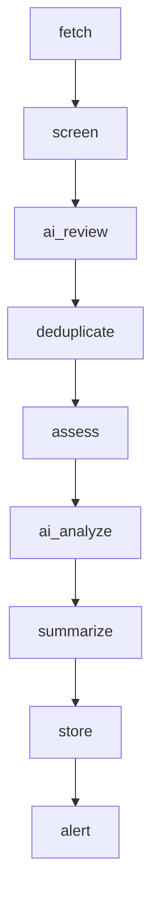

# Agent 2 — Educational RFP & Tender Research

Finds education and training tenders (RFPs, RFQs) in **Egypt** and **Saudi Arabia only**, extracts the
key facts, removes anything out of scope, expired or duplicated, gives a first "may the academy
qualify?" assessment, and stores the result in the shared database for the dashboard and the chat.

## What it does (brief requirements → where)

| Requirement | Where |
|---|---|
| Search approved sources | Live, real tenders: `src/rfp/worldbank.py` (**World Bank** API, Egypt), `src/rfp/etimad.py` (**Etimad**, Saudi government portal), `src/rfp/ungm.py` (**UN Global Marketplace**, Egypt + Saudi Arabia); `src/rfp/sources.py` — `TenderSource` protocol + `JsonFileSource` (synthetic demo feed, tests only) |
| Read the real notice documents | `src/rfp/documents.py` — notice HTML → text; requirement sentences and the deadline read from the document when not given as fields |
| Identify training categories (6 from the brief) | `extraction.classify()` — bilingual keyword rules |
| Extract title, organization, country, deadline, eligibility, category, link, publication date, documents | `extraction.extract()` → `Opportunity` |
| **Strict Egypt / Saudi filter** | `extraction.detect_country()` + `screening.screen()` |
| Filter unrelated and expired | `screening.screen()` |
| Detect duplicates | `screening.DuplicateDetector` (same link, or same organization + ≥ 88 % similar title) |
| Short AI summary | `summary.py` — LLM summary of each **new** tender whenever an LLM is configured; deterministic fallback |
| Identify relevant opportunities (AI) | `ai.py` + pipeline `ai_review` — the LLM re-reads near-misses and may keep them with a verified evidence quote |
| Assess whether the academy may qualify | `qualification.assess()` — catalog topic match + requirements to verify; pipeline `ai_analyze` adds LLM-read requirements, deadline and fit explanation, each verified against the notice |
| Store in a searchable dashboard | `rfp_opportunities` table (migration 0002) + `admin_pages/3_RFP_Opportunities.py` (filters, search, CSV export for Excel / Google Sheets) |
| Alerts for new relevant RFPs | new **Egypt** opportunities are flagged and listed as alerts on scan, in chat and on the dashboard |
| **Business rule:** Egypt → immediate review; Saudi → monitored | `screening.initial_status()` |

## Scan pipeline (LangGraph)

| Step | Does |
|---|---|
| fetch | reads every source; a missing or broken feed is reported, never crashes the scan |
| screen | extracts fields, then applies the rules **in order**: market → training-related → not expired. Each excluded listing gets exactly one reason |
| ai_review | **LLM** (only if configured): re-reads tenders rejected *only* as "not training" (right country, still open). Kept only if the LLM quotes a sentence that is really in the notice **and** talks about learning |
| deduplicate | against the database and inside the batch; the same tender seen again is *refreshed*, a re-post is *excluded* |
| assess | fit = strong / possible / weak with reasons (never "qualifies") |
| ai_analyze | **LLM** (only if configured) reads the notice of each new tender: requirements, deadline, fit explanation, matching tracks. Only verified parts are used (see below); the rules are re-run with the new facts |
| summarize | LLM summary for new tenders (deterministic fallback; rejected if it drops the deadline) |
| store | upsert by `dedup_key`; human decisions (reviewed / dismissed) are never overwritten; past deadlines become `expired` |
| alert | new Egypt opportunities → alerts, `alerted_at` set so they are not re-alerted |

## The AI steps (`src/rfp/ai.py`)
One LLM call per tender reads the notice and answers in JSON: is it a training request, an exact evidence
sentence, the requirements, the deadline, a short fit explanation and matching track IDs. The notice is sent
as data inside `<notice>` tags with an instruction to ignore any instructions in it.

**Every part of the answer is checked before it is used:**
| LLM says | Used only if |
|---|---|
| "this is training" (rescue) | the evidence sentence is really in the notice (≥ 25 characters, compared after normalisation) **and** mentions training, skills, learning or education |
| a requirement | most of its content words appear in the notice (no invented ISO certificates or guarantees) |
| a deadline | the rules found none, and its day and year appear in the notice; a past deadline then excludes the tender |
| a track ID | it exists in the academy catalog |
| a fit explanation | it does not claim the academy qualifies |

**What the LLM can never do:** see or change out-of-market tenders (the country rule runs first), set the
fit level (rules decide; the LLM can only lift WEAK to POSSIBLE when it finds a matching track), or hide a
failure: if the call fails or the JSON is invalid, the rule-based result is kept and the scan says so.
Everything rejected is counted ("N unverified item(s) ignored"). Calls are capped per scan
(`RFP_AI_MAX_CALLS`, default 20); stored AI results are kept when a later scan runs without the LLM.

Turn it on: `LLM_PROVIDER=groq` + `GROQ_API_KEY` (free tier) in `.env`. `RFP_AI` and `RFP_LLM_SUMMARIES`
default to `auto` (on whenever an LLM is configured).

## Rules in detail

**Country (strict).** An explicit country field wins (`Egypt`, `مصر`, `KSA`, `المملكة العربية السعودية`…).
Without one, cities (Cairo, الإسكندرية, Riyadh, جدة…) and government domains (`.gov.eg`, `.gov.sa`) decide.
Both markets mentioned, or neither → `UNKNOWN` → excluded. Any other country → excluded.

**Training-related.** Category words alone are not enough: "Supply of IT hardware" mentions IT but is not
training. A listing must also contain a training signal (training, courses, upskilling, تدريب, دورات, تأهيل…).

**Dates.** ISO, `dd/mm/yyyy` (day-first, as used in both markets), `Nov 15, 2026`, Arabic month names and
Arabic-Indic digits. Hijri dates are **not converted** in the MVP: the deadline is shown as unknown, never guessed.

**Fit.** STRONG = topic matches an academy track, requirements are published and none needs checking.
POSSIBLE = match but something to verify (registration, licence/TVTC, ISO, years of experience, bank
guarantee, Saudization, similar projects) or requirements unpublished; or general training with no track.
WEAK = no track match and requirements to verify. The text always says it is a first assessment.

## Use it
- Dashboard: sidebar → **RFP Opportunities** → *Run scan*. Review an opportunity, mark it reviewed or dismissed, export CSV.
- Chat: `scan` · `egypt` · `saudi` · `RFP-1A2B3C`, or in Arabic `ابحث` · `مصر` · `السعودية`.
- Settings: `RFP_SOURCES=worldbank,etimad,ungm` (default: the three live sources; add `file` for the synthetic demo feed), `RFP_FEED_PATH`,
  `RFP_MAX_PAGES` (result pages per search on Etimad / UNGM, default 3), `RFP_WORLDBANK_ROWS` (newest notices per country, default 100), `RFP_HTTP_TIMEOUT_SECONDS` (20), `RFP_AI=auto|on|off`, `RFP_LLM_SUMMARIES=auto|on|off` (auto = on when an LLM is configured), `RFP_AI_MAX_CALLS` (20).

## Data

### Real tenders: World Bank Procurement Notices API
`GET https://search.worldbank.org/api/v2/procnotices?format=json&fl=*&project_ctry_name_exact=<country>`, free,
no API key, data under CC BY 4.0. Each notice is an official procurement notice for a World Bank-financed project,
published by the borrowing government (e.g. an Egyptian ministry), and includes the **full notice document** (HTML).

- Queried for `Egypt, Arab Republic of` and `Saudi Arabia`, newest first.
- **Contract-award notices are skipped**: they announce who already won, so they are not opportunities.
- Classification uses the title and the short description; the **full document** is read separately for
  requirements and the deadline, so a goods tender that only mentions "training of operators" is not kept.
- Each kept notice links to `https://projects.worldbank.org/en/projects-operations/procurement-detail/<id>`.
- **Coverage, honestly:** Egypt has World Bank notices, but only a few are open training calls at any time, so a
  scan may keep 0–3. The World Bank does not lend to Saudi Arabia, so the Saudi query normally returns 0.
- If the API cannot be reached (no internet), the scan reports it and continues with the other sources.

### Real tenders: Etimad (Saudi Arabia)
Etimad (`tenders.etimad.sa`) is the official Saudi government procurement portal. Its tender list is public for
visitors; the visitor page loads it from `GET /Tender/AllSupplierTendersForVisitorAsync`, which `EtimadSource` reads:
open tenders only (`TenderCategory=2`), published in the last 3 months (`PublishDateId=5`), searched with Arabic
training keywords (`تدريب`, `تأهيل`, `دورات`, `بناء القدرات`…), 24 rows per page, pages read in order with a 1-second
pause. Each row gives the Arabic tender name, agency, type, activity, Gregorian dates and the link to its public
details page. Bidding and the tender booklet need a supplier account. This endpoint is not a documented API, so
a change on Etimad's side is reported on the dashboard and the other sources still run.

### Real tenders: UN Global Marketplace (Egypt + Saudi Arabia)
UN agencies (UNDP, UNICEF, UNIDO, UNESCO…) publish their notices on UNGM (`www.ungm.org`), including their country
offices in Egypt and Saudi Arabia, which often ask for training and capacity building. `UngmSource` reads UNGM's
country IDs from the public notice page, then calls the page's search (`POST /Public/Notice/Search`) for **active**
notices in Egypt and Saudi Arabia. If the IDs cannot be found it searches training keywords and keeps only rows whose
country is Egypt or Saudi Arabia. The HTML parsing lives in `parse_rows()` so it is easy to adjust.

Check the live sources from your own internet connection (nothing is stored):
`python -m src.rfp.check_sources` (or one source: `python -m src.rfp.check_sources etimad`).

### Demo feed (tests only)
`data/rfp/sample_tenders.json` is a **synthetic** feed: invented organizations (marked "fictional") and
`example.com` links, built so every rule is exercised. It is labelled synthetic in the feed, the database,
the chat and the dashboard. It is **not** scanned by default; the tests use it (`RFP_SOURCES=file`). When the
demo feed is not a configured source, demo rows left from earlier scans are deleted at start-up.

## Tests (`python -m pytest tests/test_rfp_*.py`)
| File | Covers |
|---|---|
| test_rfp_extraction.py | date formats incl. Arabic, Hijri → unknown, country field / city / domain / ambiguous, whole-word matching, IT procurement vs training |
| test_rfp_rules.py | each exclusion reason, Egypt-flagged / Saudi-monitored rule, duplicates, fit levels, LLM summary fallbacks |
| test_rfp_agent.py | migration, full demo-feed scan, idempotent re-scan, no re-alert, human decision kept, later expiry, broken feeds, chat EN + AR |
| test_rfp_dashboard.py | headless dashboard: scan, Egypt alert banner, table, dismiss button |
| test_rfp_ai.py | LLM steps with a fake LLM: rescue only with a real learning quote, invented requirements / deadlines / track IDs dropped, past AI deadline excludes, LLM failure keeps rules result, call limit, AI work kept on re-scan, never "qualifies", notice sent as data, settings |
| test_rfp_live_sources.py | Etimad and UNGM with faked portals (offline): field mapping, in-order paging, keyword dedup, percent-encoded links, UNGM country IDs and fallback, only Egypt/Saudi kept, both markets in one scan, demo rows removed, live-only default |
| test_rfp_worldbank.py | World Bank source with a faked API (offline): field mapping, award notices skipped, notice-document parsing (requirements, deadline), goods vs training, API unreachable, real + demo sources together, `RFP_SOURCES` setting |

## Known limitations (next sprint)
- Etimad and UNGM are read through their public web endpoints, not documented APIs: they can change without notice.
- Egypt's own government portal (EPS-GAGS / etenders.gov.eg) is not connected yet; Egypt comes from the World Bank and UNGM.
- Hijri deadlines are not converted.
- Alerts are in-app only (no email/WhatsApp yet).
- Without an LLM, relevance and requirements are keyword-based. With an LLM, unusual wording is caught, but only verified parts are used, so some correct LLM findings may also be dropped.